# DX11_3D_GameProject_Team

**DirectX 11 기반 3D 액션 플랫포머 — 「별의 커비 디스커버리」 모작 (4인 팀 프로젝트)**

[개요](#개요) · [하이라이트](#하이라이트) · [내 담당](#내-담당) · [주요 구현](#주요-구현) · [회고](#회고) · [기술 스택](#기술-스택)

---

## 개요

DirectX 11 기반의 자체 엔진 프레임워크를 활용해 만든 「별의 커비 디스커버리」 모작입니다.<br/>
원작 리소스를 직접 변환해 쓰고, 원작 배치 데이터를 그대로 읽어 몬스터 · 기믹을 배치했습니다.<br/>
4인 팀 프로젝트로, 저는 몬스터 AI · 애니메이션 · 툴을 맡았습니다.

| | |
| --- | --- |
| 기간 | 2026.05.28 ~ 2026.08.02 (약 10주) |
| 인원 | 4인 |
| 규모 | 몬스터 14종 · 공용 몬스터 상태 16종 · 툴 8종 |

| 팀원 | 담당 |
| --- | --- |
| [Marb1e0817](https://github.com/Marb1e0817) | 팀장 · 렌더링 · 엔진 코어 · 보스 AI · UI · 카메라 |
| [yoonseungeon](https://github.com/yoonseungeon) | 플레이어(커비) · 능력 복사 · 변신 · 이펙트 시스템 |
| [leolee-12](https://github.com/leolee-12) | 레벨 · 맵 툴 · 맵 로더 · 환경 오브젝트 · 컬링 |
| **[ddoichaboom](https://github.com/ddoichaboom)** | **몬스터 AI · Animator 확장 · 원작 리소스 파이프라인 · 툴** |

---

## 하이라이트

<table>
  <tr>
    <td width="50%">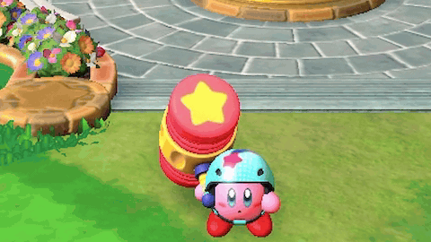<br/><sub><b>애니메이션 오버레이</b></sub></td>
    <td width="50%">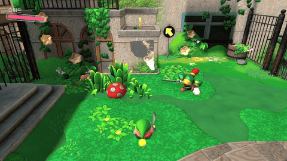<br/><sub><b>AI 변종</b></sub></td>
  </tr>
  <tr>
    <td>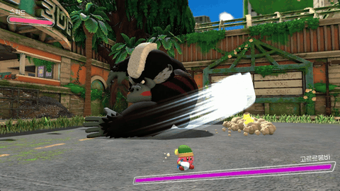<br/><sub><b>드랍 별</b></sub></td>
    <td>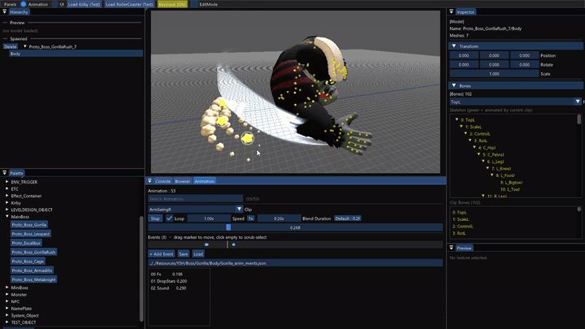<br/><sub><b>AnimUITool</b></sub></td>
  </tr>
</table>

---

## 내 담당

#### □ 애니메이션
- Animator에 애니메이션 오버레이(레이어 스택 · 본 마스킹) · 진행도 연동 연출 · 애니메이션 큐 추가

#### □ 몬스터 AI
- 지각 · 판단 · 실행을 나눈 몬스터 AI 프레임워크와 공용 상태 16종
- 몬스터 14종 (전용 판단 · 상태 12종, 공용 상태만 쓰는 2종)

#### □ 이동 · 물리
- PhysX 기반 몬스터 이동 컴포넌트 · 레일 이동

#### □ 게임플레이 기믹
- 메테오 · 드랍 별 · 능력 방울

#### □ 사운드
- 사운드 핸들 · 구간 반복 · BGM 페이드 · 믹싱
- 몬스터 사운드 · 구역 환경음 · BGM 구역

#### □ 렌더링 · 최적화
- 몬스터 디더링 페이드 · 폭탄 도화선 셰이더
- 거리 기반 애니메이션 갱신 주기 · 위상 분산

#### □ 툴 · 파이프라인
- 애니메이션 이벤트 저작 툴 AnimUITool (ImGui)
- 원작 리소스 변환 툴 AnimModelTool (C#) 외 보조 툴

> 커비 조작 · 능력 복사 · 변신, 보스 AI 본체, 렌더링 · 엔진 코어, 맵 툴 · 레벨,<br/>
> 이펙트 시스템은 팀원 작업입니다.

---

## 주요 구현

[1. 애니메이션](#1-애니메이션) · [2. 몬스터 AI](#2-몬스터-ai) · [3. 이동 · 물리](#3-이동--물리) · [4. 게임플레이 기믹](#4-게임플레이-기믹)<br/>
[5. 사운드](#5-사운드) · [6. 렌더링 · 셰이더](#6-렌더링--셰이더) · [7. 최적화](#7-최적화) · [8. 툴 · 리소스 파이프라인](#8-툴--리소스-파이프라인)

## 1. 애니메이션

### ■ Animator

팀 초기 Animator는 클립 하나를 재생하고, 다음 클립으로 넘어갈 때 보간하는 골격이었습니다.<br/>
원작 분석 결과 **하나의 클립이 아닌 여러 클립이 복합적으로 구성된 동작 방식**을 확인했습니다.<br/>
이를 재현하기 위해 골격 위에 아래 기능을 차례로 붙였습니다.

<p align="center">
  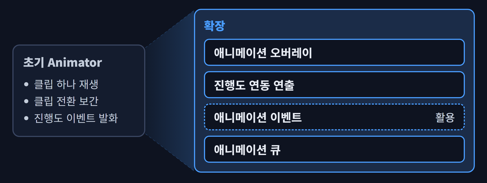
</p>

<details>
<summary><b>세부 구현 사항</b></summary>

#### □ 주요 함수

| 주요 함수 | 기능 | 설명 |
| --- | --- | --- |
| `Apply_Overlay` · `Clear_Overlay` | 레이어 스택 | 슬롯에 클립 넣기 · 바꾸기 · 빼기, 가중치 지정 |
| `CModel::Build_MaskBones` | 본 마스킹 | 시작 본과 그 자식 본 전체를 마스크로 채움 |
| `CModel::Apply_Mask` | 레이어 적용 | 레이어 시간으로 샘플링해 마스크 본만 덮어씀 |
| `CModel::Update_Combined` | 결합 1회 | 모든 레이어 적용 후 부모 → 자식 결합 한 번 |
| `TiltByProgress` · `SpinByProgress` | 진행도 연동 연출 | 진행도로 본 각도를 계산해 회전을 덧붙임 |
| `Enqueue` | 애니메이션 큐 | 현재 클립이 끝나면 예약한 클립을 이어서 재생 |

#### □ Animator와 Model의 역할

Animator는 무엇을 언제 재생할지 정하고, Model은 본 데이터로 실제 포즈를 계산합니다.

| 구분 | Animator | Model |
| --- | --- | --- |
| 재생 상태 | 레이어 1 ~ 3 (클립 · 시간 · 가중치) | 베이스 (현재 클립 · 재생 위치 · 전환 보간) |
| 데이터 | 애니메이션 큐 · 이벤트 트랙 · 본 회전 요청 | 본 · 클립 |
| 하는 일 | 가중치 갱신 · 이벤트 판정 · 다음 클립 시작 | 베이스 재생 · 레이어 샘플링 · 본 회전 · 결합 |

- 클립 · 본 · 본 계층처럼 계산에 필요한 데이터는 모두 Model에 있어, 계산은 Model이 맡고 Animator는 레이어 상태만 넘김
- 베이스는 예전 구조대로 Model이 상태까지 가짐

</details>

#### □ 한 프레임의 흐름

Animator는 매 프레임 `Update`에서 아래 네 단계를 차례로 진행하고, 포즈 계산은 Model이 맡습니다.

<p align="center">
  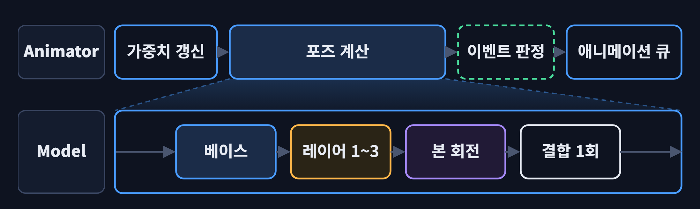
</p>

<details>
<summary><b>세부 구현 사항</b></summary>

```cpp
for (_uint iSlot = 1; iSlot < MAX_LAYERS; ++iSlot)                   // 가중치 갱신
    /* 목표 쪽으로 Δt / 가중치 블렌드 시간씩, 목표 0 · 가중치 0이면 슬롯 비움 */;

if (!m_bPaused)                                                     // 포즈 계산
{
    m_bFinished = m_pModel->Update_Base(fTimeDelta, m_fPlaySpeed);  // 베이스
    for (_uint iSlot = 1; iSlot < MAX_LAYERS; ++iSlot)              // 레이어 1 ~ 3
        if (!m_Layers[iSlot].strClip.empty() && m_Layers[iSlot].fWeight > 0.f)
            m_Layers[iSlot].bFinished = m_pModel->Apply_Mask(m_Layers[iSlot], fTimeDelta);
    /* … 본 회전 (RotateBone) */
    m_pModel->Update_Combined();                                    // 결합 1회
}

/* 이벤트 판정 — (이전 진행도, 현재 진행도] 구간 */
/* 애니메이션 큐 — 베이스가 끝났고 큐가 비어 있지 않으면 맨 앞 클립을 Start_Clip */
```

<sub>코드 · [`CAnimator::Update`](https://github.com/ddoichaboom/DX11_3D_GameProject_Team/blob/5cf52376ca5d1a02ebb6c31256e7fa08ef0c6b49/AAA/Engine/Private/Animator.cpp#L329-L445)</sub>

</details>

### ■ 애니메이션 오버레이

무기를 든 커비의 대기 동작은 기본 대기 클립 위에 무기를 든 팔만 다른 클립이 덮인 형태였습니다.<br/>
이런 **일부 본에만 다른 클립을 덮는 오버레이**를 레이어 스택과 본 마스킹으로 구현했습니다.

<table>
  <tr>
    <td width="50%">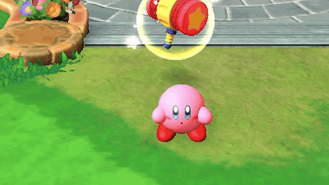<br/><sub><b>기본 대기</b></sub></td>
    <td width="50%"><br/><sub><b>무기를 든 대기</b></sub></td>
  </tr>
</table>

#### □ 레이어 스택

애니메이션 레이어(`LAYER`)는 애니메이션 클립 하나를 재생하는 단위입니다.<br/>
0번 슬롯은 Model이 재생하는 베이스이고, 그 위 슬롯마다 레이어를 하나씩 쌓습니다.

<p align="center">
  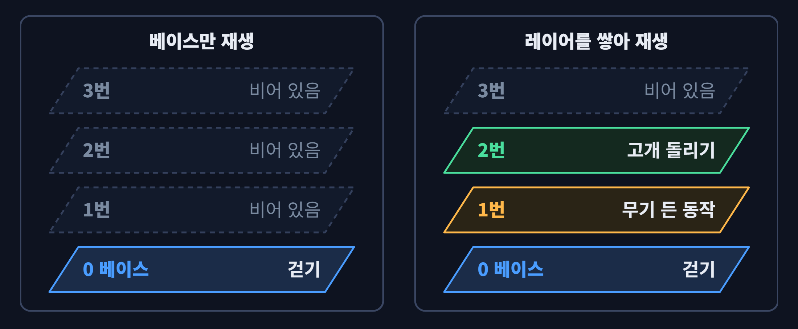
</p>

<details>
<summary><b>세부 구현 사항</b></summary>

| 묶음 | 담긴 것 |
| --- | --- |
| 무엇을 | 재생할 클립 · 덮어쓸 마스크 본 목록 |
| 재생 | 레이어 자기 시간 · 키프레임 커서 · 속도 · 반복 · 일시정지 · 종료 여부 |
| 가중치 | 현재 가중치 · 목표 가중치 · 목표까지 가는 시간 |
| 클립 교체 | 이전 클립의 시간 · 커서 · 교차 보간 시간 |

레이어는 요청 구조체(`LAYER_PLAY_INFO`)로 넣고, Animator가 이를 풀어 `LAYER`에 보관합니다.

- **슬롯**
  - 몇 번 레이어에 넣을지
- **클립 정보** (`ANI_PLAY_INFO`)
  - 베이스 재생(`Play` · `Enqueue`)과 같은 구조체
  - 베이스와 레이어가 같은 형식으로 클립을 요청
- **시작 본 목록**
  - 자식 본까지 펼친 마스크 본 목록으로 보관
- **목표 가중치 · 블렌드 시간**
  - 매 프레임 가중치를 목표까지 옮길 때 사용

```cpp
struct ANI_PLAY_INFO                            // 클립 요청 — 베이스 · 레이어 공용
{
    _string     strAniName;
    _bool       bLoop{ true };
    _bool       bRestart{ false };              // 처음부터
    _float      fBlend = { 0.2f };              // 교차 시간
    _float      fSpeed = { 1.f };
};

struct LAYER_PLAY_INFO                          // 레이어 요청 — 사용하는 쪽이 채움
{
    _uint               iSlot = { 1 };
    ANI_PLAY_INFO       tAnim;                  // 위의 클립 요청
    vector<_string>     Roots;                  // 마스크 시작 본
    _float              fTargetWeight = { 1.f };
    _float              fWeightBlend = { 0.1f };
};

struct LAYER                                    // 보관 — Animator가 풀어서 가짐
{
    _string         strClip;                    // 무엇을 — 재생 중 클립 ("" = 비활성)
    _float          fLocalTime = { 0.f };       // 재생 — 레이어 자기 시간
    _float          fClipBlend = { 0.f };       // 클립 교체 — 교차 보간 시간
    _int            iPrevAnimIndex = { -1 };    // 클립 교체 — 이전 클립
    _float          fWeight = { 0.f };          // 가중치 — 현재 가중치
    _float          fSpeed = { 1.f };           // 재생 — 속도
    _bool           bLoop = { true };           // 재생 — 반복
    _bool           bPaused = { false };        // 재생 — 일시정지
    vector<_uint>   MaskBones;                  // 무엇을 — 마스크 본 인덱스
    // ...
};
```

<sub>코드 · [`ANI_PLAY_INFO · LAYER_PLAY_INFO`](https://github.com/ddoichaboom/DX11_3D_GameProject_Team/blob/5cf52376ca5d1a02ebb6c31256e7fa08ef0c6b49/AAA/Engine/Public/Animator.h#L13-L29) · [`LAYER`](https://github.com/ddoichaboom/DX11_3D_GameProject_Team/blob/5cf52376ca5d1a02ebb6c31256e7fa08ef0c6b49/AAA/Engine/Public/Anim_Layer.h#L8-L34)</sub>

</details>

#### □ 본 마스킹

<p align="center">
  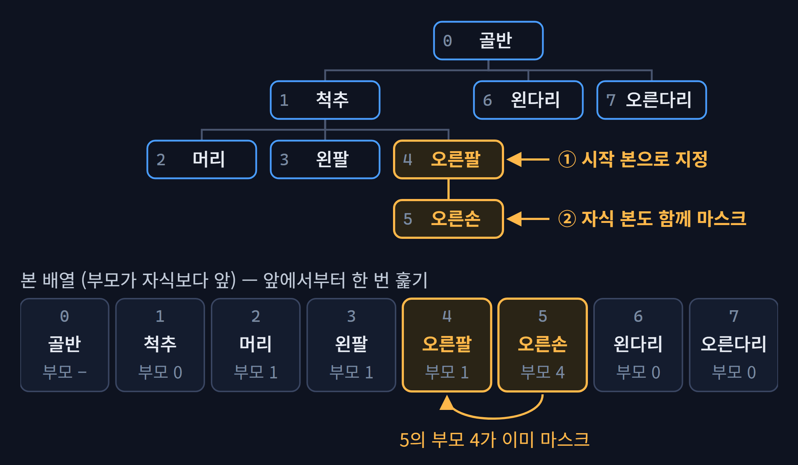
</p>

<details>
<summary><b>세부 구현 사항</b></summary>

- 시작 본 이름만 주면 그 본과 자식 본 전체가 마스크가 됨 (여러 개 가능, 비우면 전신)
- 본 배열은 부모가 자식보다 앞에 있음
- 그래서 한 번 훑으며 "부모가 표시된 본"을 표시하면 서브트리가 완성됨

```cpp
vector<char> masked(n, 0);
for (const _string& strRoot : Roots)                 // 1) 시작 본만 표시
{
    _int iRoot = Get_BoneIndex(strRoot);
    if (iRoot >= 0)
        masked[iRoot] = 1;
}
for (_uint i = 0; i < n; ++i)                        // 2) 부모가 자식보다 앞 → 한 번에 서브트리
{
    if (masked[i])
        continue;
    _int p = Get_BoneParentIndex(i);
    if (p >= 0 && masked[p])
        masked[i] = 1;
}
for (_uint i = 0; i < n; ++i)                        // 3) 인덱스 목록으로 수집
    if (masked[i])
        OutBones.push_back(i);
```

<sub>코드 · [`CModel::Build_MaskBones`](https://github.com/ddoichaboom/DX11_3D_GameProject_Team/blob/5cf52376ca5d1a02ebb6c31256e7fa08ef0c6b49/AAA/Engine/Private/Model.cpp#L428-L470)</sub>

</details>

#### □ 가중치와 교차 보간

<p align="center">
  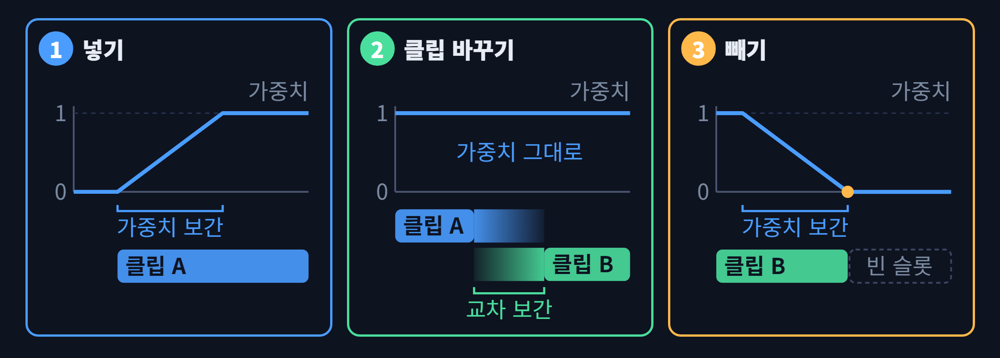
</p>

<details>
<summary><b>세부 구현 사항</b></summary>

- **가중치 보간**
  - 가중치는 레이어가 마스크 본을 얼마나 덮을지 정하는 값 (0 ~ 1)
  - 넣을 때는 0에서 목표까지 올리고, 뺄 때는 0까지 내린 뒤 슬롯을 비움
  - 쓰는 쪽은 빼기 요청 한 번이면 페이드아웃과 정리까지 끝남
- **교차 보간**
  - 같은 슬롯에 다른 클립이 오면, 이전 클립을 계속 재생하며 새 클립으로 넘어감
  - 가중치와 따로 움직여, 덮는 정도는 그대로 두고 클립만 바꿀 수 있음
- **섞는 방식**
  - 두 보간 모두 위치 · 크기는 Lerp, 회전은 쿼터니언 Slerp로 섞음
  - 두 회전의 내적이 음수면 부호를 뒤집어 짧은 쪽으로 회전

```cpp
// 교차 보간 비율 — 교차 시간 기준, 가중치와 따로
animLayer.fClipBlendElapsed += fDelta;
t = (animLayer.fClipBlend > 0.f) ? (animLayer.fClipBlendElapsed / animLayer.fClipBlend) : 1.f;

auto BlendToBone = [&](_uint iBone, const KEYFRAME& ov)    // 가중치(fWeight)로 섞기
{
    _vector vS = XMLoadFloat3(&ov.vScale), vR = XMLoadFloat4(&ov.vRotation),
            vT = XMLoadFloat3(&ov.vTranslation);
    if (animLayer.fWeight < 1.f)
    {
        _vector bS, bR, bT;
        // 지금 본 행렬 (베이스 + 아래 레이어)
        XMMatrixDecompose(&bS, &bR, &bT, m_Bones[iBone]->Get_TransformationMatrix());
        if (XMVectorGetX(XMVector4Dot(bR, vR)) < 0.f)
            vR = XMVectorNegate(vR);   // 최단 경로
        vS = XMVectorLerp(bS, vS, animLayer.fWeight);
        vR = XMQuaternionSlerp(bR, vR, animLayer.fWeight);
        vT = XMVectorLerp(bT, vT, animLayer.fWeight);
    }
    m_Bones[iBone]->Set_TransformationMatrix(
        XMMatrixAffineTransformation(vS, XMVectorSet(0, 0, 0, 1), vR, XMVectorSetW(vT, 1.f)));
};
for (_uint iBone : animLayer.MaskBones)
{
    KEYFRAME ov = it->second;                    // 새 클립 포즈
    if (bCrossfade)
        ov = LerpKF(itp->second, ov, t);         // ① 교차: 이전 클립 → 새 클립 (비율 t)
    BlendToBone(iBone, ov);                      // ② 가중치로 섞기: 아래 포즈 → 레이어
}
```

<sub>코드 · [`CModel::Apply_Mask`](https://github.com/ddoichaboom/DX11_3D_GameProject_Team/blob/5cf52376ca5d1a02ebb6c31256e7fa08ef0c6b49/AAA/Engine/Private/Model.cpp#L472-L576)</sub>

</details>

#### □ 포즈 계산

<p align="center">
  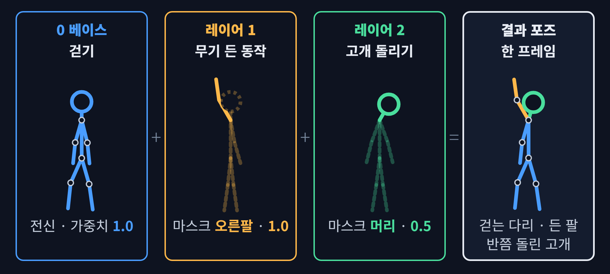
</p>

<details>
<summary><b>세부 구현 사항</b></summary>

- **베이스**
  - 본마다 지역 행렬을 베이스 클립 값으로 채움
- **레이어**
  - 1번 슬롯부터 번호 순으로, 레이어마다 자기 클립을 자기 시간으로 샘플링
  - 마스크 본에만 가중치만큼 덮어씀 (교차 중이면 이전 클립과 먼저 섞음)
- **본 회전**
  - 요청된 본의 회전에 각도를 덧붙임

</details>

#### □ 결합 1회

부모 → 자식 결합은 레이어가 몇 개든 **스키닝 직전에 한 번만** 합니다.

<p align="center">
  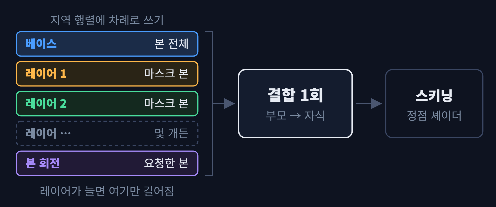
</p>

<details>
<summary><b>세부 구현 사항</b></summary>

- 기존 재생 함수의 샘플링과 결합을 둘로 나누고, 그 사이에 레이어 · 본 회전을 넣음
- 베이스 · 레이어 · 본 회전은 지역 행렬만 고치고, 결합은 마지막에 한 번
- 레이어가 늘어도 결합 비용은 그대로

</details>

### ■ 진행도 연동 연출

애니메이션 진행도는 재생 위치를 클립 길이로 나눠 0 ~ 1로 정규화한 값입니다.<br/>
이 진행도로 각도를 계산해, 기울어짐 · 회전처럼 클립 외의 연출을 본에 덧붙였습니다.<br/>
클립 길이가 달라도 같은 식을 쓰고, 따로 타이머 없이 클립의 시작 · 끝과 맞춰 움직입니다.

#### □ 기울어짐

<p align="center">
  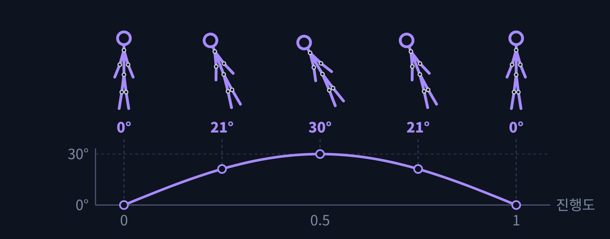
</p>

<details>
<summary><b>세부 구현 사항</b></summary>

- 각도는 진행도 p에 대해 `최대각 × sin(π · p)`로, 처음과 끝은 0이고 가운데서 가장 큼
- 넉백 중에는 몸통 본을 최대 30도 젖혔다가 되돌림

```cpp
void CAnimator::TiltByProgress(const _char* szBone, _float fPeakDeg, _fvector vAxis, _uint iSlot)
{
    _float fProgress = Get_LayerProgress(iSlot);
    _float fAngle = fPeakDeg * sinf(XM_PI * fProgress);     // 0 → 최대 → 0
    SetBoneRotation(szBone, fAngle, vAxis);
}
```

<sub>코드 · [`CAnimator::TiltByProgress`](https://github.com/ddoichaboom/DX11_3D_GameProject_Team/blob/5cf52376ca5d1a02ebb6c31256e7fa08ef0c6b49/AAA/Engine/Private/Animator.cpp#L126-L131)</sub>

</details>

#### □ 회전

<p align="center">
  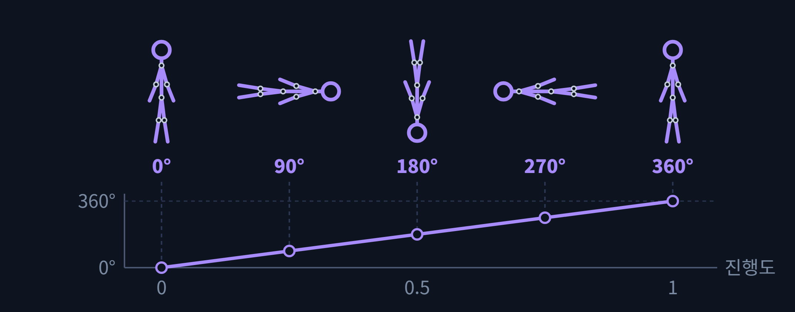
</p>

<details>
<summary><b>세부 구현 사항</b></summary>

- 각도는 `360° × 회전 수 × p`로, 진행도에 비례해 늘어남
- 한 방에 쓰러져 날아갈 때는 몸통 본을 한 바퀴 돌림

```cpp
void CAnimator::SpinByProgress(const _char* szBone, _float fTurns, _fvector vAxis, _uint iSlot)
{
    _float fProgress = Get_LayerProgress(iSlot);
    _float fAngle = 360.f * fTurns * fProgress;             // 진행도에 비례
    SetBoneRotation(szBone, fAngle, vAxis);
}
```

<sub>코드 · [`CAnimator::SpinByProgress`](https://github.com/ddoichaboom/DX11_3D_GameProject_Team/blob/5cf52376ca5d1a02ebb6c31256e7fa08ef0c6b49/AAA/Engine/Private/Animator.cpp#L119-L124)</sub>

</details>

#### □ 본에 회전 반영

<p align="center">
  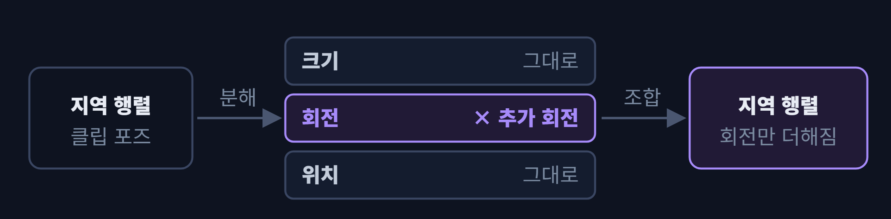
</p>

<details>
<summary><b>세부 구현 사항</b></summary>

- 회전은 레이어별 애니메이션 클립들이 본의 지역 행렬에 적용된 뒤 본에 반영
- 지역 행렬에서 회전만 꺼내 쿼터니언으로 곱하고, 크기 · 위치는 그대로 다시 조합
- 그래서 클립 포즈 위에 회전만 더해짐

</details>

### ■ 애니메이션 이벤트

공격음 · 이펙트처럼 애니메이션과 함께 나와야 하는 연출은 클립의 특정 시점에 묶여야 했습니다.<br/>
Animator의 기존 이벤트 발화를 활용해, 이 시점을 코드가 아닌 애니메이션 데이터에 담았습니다.<br/>
이벤트는 진행도 한 점의 POINT와, 구간 시작 · 끝의 BEGIN · END로 발화합니다.

<p align="center">
  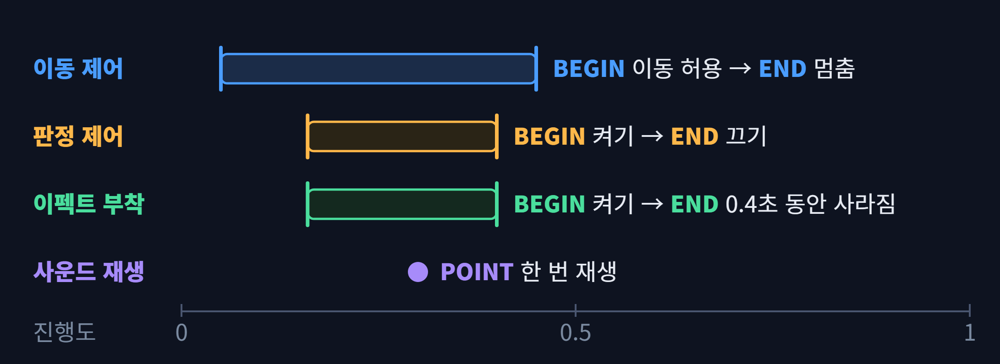
</p>

### ■ 애니메이션 큐

공격 준비 → 공격처럼 여러 클립이 차례로 이어지는 동작도 많았습니다.<br/>
상태 코드에서 여러 클립을 하나의 시퀀스로 재생할 수 있도록 애니메이션 큐를 도입했습니다.

<p align="center">
  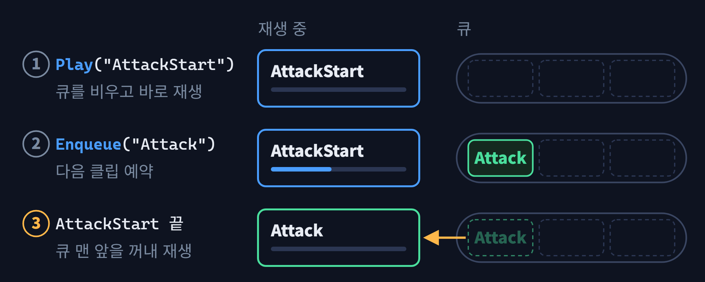
</p>

<details>
<summary><b>세부 구현 사항</b></summary>

- 새 애니메이션을 재생할 때
  - `Play`가 큐를 비우고 `Start_Clip`으로 재생
  - 공격 도중 넉백되면 남은 공격 예약까지 지워져, 공격 클립이 뒤늦게 나오지 않음
- 큐에서 꺼내 연달아 재생할 때
  - 앞 클립이 끝나면 맨 앞을 꺼내 `Start_Clip`만 호출해, 남은 예약은 그대로 둠

```cpp
void CAnimator::Play(const ANI_PLAY_INFO* tAniInfo)
{
    /* … */
    m_PlayQueue.clear();                // 새 재생은 남은 예약을 지움
    Start_Clip(*tAniInfo);
}

void CAnimator::Enqueue(const ANI_PLAY_INFO& info)
{
    m_PlayQueue.push_back(info);        // 재생 정보(클립 · 반복 · 보간 시간 · 속도)째 예약
}

// CAnimator::Update 끝 — 베이스 클립이 끝났으면 맨 앞을 꺼내 재생
if (m_bFinished && !m_PlayQueue.empty())
{
    ANI_PLAY_INFO next = m_PlayQueue.front();
    m_PlayQueue.pop_front();
    Start_Clip(next);                   // Play가 아니라서 남은 예약은 그대로
}
```

<sub>코드 · [`CAnimator::Play`](https://github.com/ddoichaboom/DX11_3D_GameProject_Team/blob/5cf52376ca5d1a02ebb6c31256e7fa08ef0c6b49/AAA/Engine/Private/Animator.cpp#L59-L67) · [`CAnimator::Enqueue`](https://github.com/ddoichaboom/DX11_3D_GameProject_Team/blob/5cf52376ca5d1a02ebb6c31256e7fa08ef0c6b49/AAA/Engine/Private/Animator.cpp#L288-L291) · [`CAnimator::Update`](https://github.com/ddoichaboom/DX11_3D_GameProject_Team/blob/5cf52376ca5d1a02ebb6c31256e7fa08ef0c6b49/AAA/Engine/Private/Animator.cpp#L439-L444)</sub>

</details>

> Animator 골격과 애니메이션 이벤트 발화 구조는 팀장이 만들었고,<br/>
> 그 위의 오버레이 · 진행도 연동 연출 · 애니메이션 큐를 설계 · 구현했습니다.

<br/>

## 2. 몬스터 AI

일반 몬스터는 행동과 피격 · 흡입 같은 반응을 모두 상태 전환으로 다루도록 FSM으로 구성했습니다.<br/>
몬스터마다 다른 것은 판단뿐이라, **판단과 실행을 나누고 실행 상태는 공용화**했습니다.

### ■ FSM 기반 몬스터 구조

몬스터는 한 번에 한 상태만 갖고, 상태는 Enter · Update · Exit로 동작합니다.

<p align="center">
  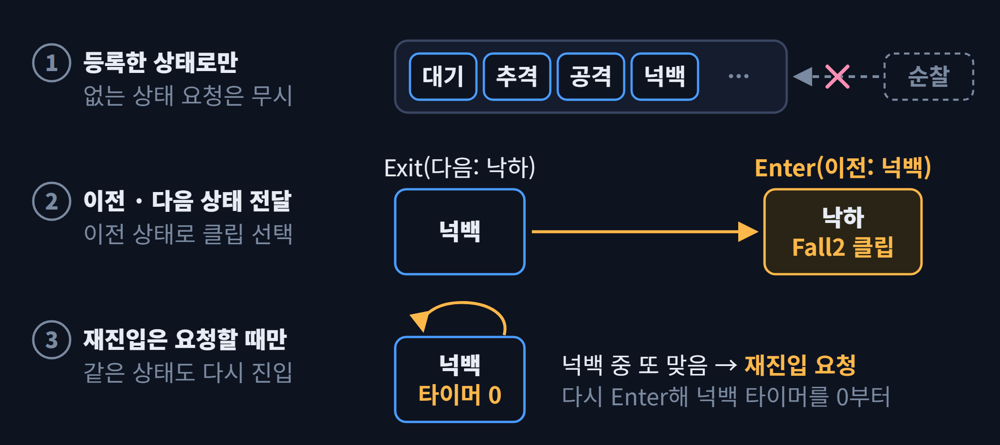
</p>

<details>
<summary><b>세부 구현 사항</b></summary>

- 등록한 상태로만 전환
  - 몬스터마다 쓰는 상태만 등록하고, 등록하지 않은 상태로는 전환되지 않음
- 이전 · 다음 상태 전달
  - Exit에 다음 상태, Enter에 이전 상태를 넘겨 이어지는 연출을 고름
- 재진입은 요청할 때만
  - 같은 상태로는 다시 들어가지 않음
  - 넉백 중 다시 맞을 때처럼 요청하면 다시 들어가 타이머를 초기화

```cpp
CMonster_State* pNextState = Find_State(eNewState);
if (nullptr == pNextState)
    return false;                                       // 등록하지 않은 상태
if (m_pCurState == pNextState && !bStateReenter)
    return true;
if (nullptr != m_pCurState)
{
    m_pCurState->Exit(eNewState);                       // 다음 상태를 알려 줌
    m_PrevState = m_pCurState->Get_StateType();
}
m_pCurState = pNextState;
m_pOwner->Get_BlackBoard().bCanTransition = m_pCurState->Is_Interruptible();
m_pCurState->Enter(m_PrevState);                        // 이전 상태를 알려 줌
```

<sub>코드 · [`CMonster_StateMachine::Change_State`](https://github.com/ddoichaboom/DX11_3D_GameProject_Team/blob/5cf52376ca5d1a02ebb6c31256e7fa08ef0c6b49/AAA/GameContent/Private/Monster_StateMachine.cpp#L27-L58)</sub>

</details>

### ■ 지각 · 판단 · 실행

상태 안에 판단까지 넣으면, 같은 행동이라도 몬스터마다 상태를 새로 만들어야 합니다.<br/>
그래서 몬스터 AI를 지각 · 판단 · 실행 세 부분으로 나누고, 매 프레임 이 순서로 돌립니다.

<p align="center">
  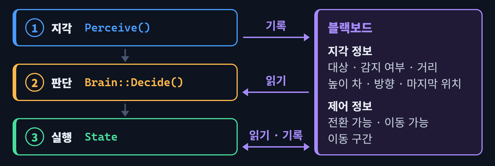
</p>

<table>
  <tr>
    <td width="50%">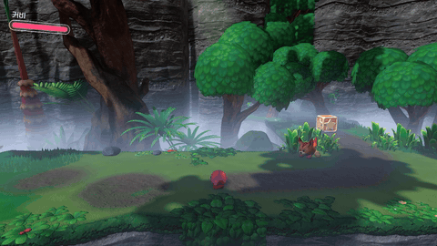<br/><sub><b>NormalEnemy 추격</b></sub></td>
    <td width="50%">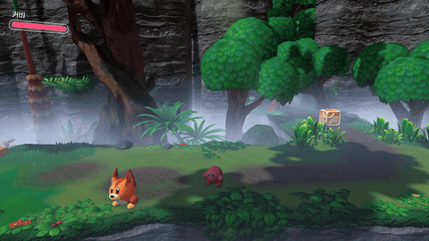<br/><sub><b>NormalEnemy 피격</b></sub></td>
  </tr>
</table>

<details>
<summary><b>세부 구현 사항</b></summary>

#### □ 블랙보드

블랙보드는 지각 · 판단 · 실행이 함께 보는 몬스터별 공용 기록판입니다.

- 지각 정보
  - 대상 · 감지 여부 · 마지막으로 본 위치
  - 3D 거리 · 수평 거리 · 높이 차 · 수평 방향
  - 지각 단계가 매 프레임 채움
- 제어 정보
  - 전환 가능 여부 · 이동 가능 여부 · 이동 구간
  - 상태 머신이 상태를 바꿀 때, 애니메이션 이벤트가 이동 구간에 들어설 때 기록

```cpp
struct MONSTER_BLACKBOARD
{
    // 지각 — 지각 단계가 매 프레임 기록
    _bool           bCanSeeTarget = { false };          // 감지 범위 안인지
    _float          fDistToTarget = { FLT_MAX };        // 3D 거리
    _float          fDistToTargetXZ = { FLT_MAX };      // 수평 거리
    _float          fHeightToTarget = {};               // 높이 차
    CGameObject*    pTarget = { nullptr };
    _float3         vTargetPos = {};
    _float3         vLastKnownPos = {};                 // 마지막으로 본 위치
    _float3         vDirToTargetXZ = {};                // 수평 방향

    // 제어 — 상태 머신 · 애니메이션 이벤트가 기록
    _bool           bCanMove = { false };               // 이동 구간 안인지
    _float          fMoveWinLo = { 0.f };               // 이동 구간 시작
    _float          fMoveWinHi = { 1.f };               // 이동 구간 끝
    _bool           bActionFinished = { false };
    _bool           bCanTransition = { true };          // 판단부가 상태를 바꿔도 되는지
};
```

<sub>코드 · [`MONSTER_BLACKBOARD`](https://github.com/ddoichaboom/DX11_3D_GameProject_Team/blob/5cf52376ca5d1a02ebb6c31256e7fa08ef0c6b49/AAA/GameContent/Public/Monster_BlackBoard.h#L48-L69)</sub>

#### □ 지각 (Perceive)

각 몬스터가 매 프레임 한 번 `Perceive`로 블랙보드의 지각 정보를 채웁니다.<br/>
상태마다 거리를 따로 계산하지 않고, 판단부와 상태는 이 값을 읽기만 합니다.

- 감지한 대상과의 3D 거리 · 수평 거리 · 높이 차와 수평 방향을 계산해 기록
- 대상이 없으면 거리를 최대값으로 둬, 판단부가 예외 처리 없이 같은 비교식을 씀

```cpp
if (nullptr == m_BlackBoard.pTarget)                    // 대상 없음 — 거리는 최대값
{
    m_BlackBoard.bCanSeeTarget = false;
    m_BlackBoard.fDistToTarget = FLT_MAX;
    m_BlackBoard.fDistToTargetXZ = FLT_MAX;
    /* … */
    return;
}
_vector vToTarget = vTargetPos - vMyPos;
_vector vToTargetXZ = XMVectorSetY(vToTarget, 0.f);     // 수평 성분만
XMStoreFloat3(&m_BlackBoard.vDirToTargetXZ, XMVector3Normalize(vToTargetXZ));   // 길이 0이면 0 벡터
m_BlackBoard.fDistToTarget   = XMVectorGetX(XMVector3Length(vToTarget));
m_BlackBoard.fDistToTargetXZ = XMVectorGetX(XMVector3Length(vToTargetXZ));
m_BlackBoard.fHeightToTarget = XMVectorGetY(vToTarget);
m_BlackBoard.bCanSeeTarget   = true;
m_BlackBoard.vLastKnownPos   = m_BlackBoard.vTargetPos;
```

<sub>코드 · [`CMonster::Perceive`](https://github.com/ddoichaboom/DX11_3D_GameProject_Team/blob/5cf52376ca5d1a02ebb6c31256e7fa08ef0c6b49/AAA/GameContent/Private/Monster.cpp#L504-L553)</sub>

#### □ 판단 (Brain)

판단부는 블랙보드를 읽고 상태 전환만 요청합니다.<br/>
판단을 Brain으로 분리해, Brain만 바꾸면 판단 방식을 바꿀 수 있습니다.

- 일반 몬스터 (FSM Brain)
  - `CMonsterBrain` → `CMonster_Brain_FSM`(공통 판단) → 몬스터별 Brain 순으로 상속
  - 몬스터별 `Decide_Internal`이 거리 · 높이 차로 공격 · 추격 · 대기를 고름
- 공통 판단
  - 흡입 · 사망 · 낙하 · 압착 같은 반응 중에는 판단을 건너뜀
  - 현재 상태가 끊김을 허용하지 않아도 건너뜀 (대기 · 이동 계열만 허용)
  - 그래서 공격 · 넉백 도중에는 판단이 끼어들지 않음
  - 대상을 잃으면 대기로, 처음 발견하면 감지 상태로 보냄
- 보스 (BT Brain)
  - 팀장이 이 Brain 자리에 페이즈별 BT(Behavior Tree)를 넣어 보스 AI를 구현

```cpp
_bool CMonster_Brain_FSM::Can_Decide(const MONSTER_BLACKBOARD& BlackBoard) const
{
    MONSTER_STATE_TYPE eCurState = m_pOwner->Get_StateType();
    // (MONSTER_STATE_TYPE:: 생략)
    if (eCurState == CAPTURED || eCurState == DEATH || eCurState == KNOCK_OUT ||
        eCurState == KNOCK_BACK_DEATH || eCurState == FALL || eCurState == LANDING ||
        eCurState == FLATTEN)
        return false;                                   // 반응 중에는 판단하지 않음
    return BlackBoard.bCanTransition;                   // 현재 상태가 끊김을 허용할 때만
}
void CMonster_Brain_FSM::Decide(const MONSTER_BLACKBOARD& BlackBoard, _float fTimeDelta)
{
    if (!Can_Decide(BlackBoard))
        return;
    if (nullptr == BlackBoard.pTarget)  { /* 발견 기록 초기화 + 대기 */ return; }
    if (!m_bSpotted && m_pOwner->Has_State(DETECT))
        { m_bSpotted = true; m_pOwner->Change_State(DETECT); return; }
    Decide_Internal(BlackBoard, fTimeDelta);            // 몬스터별 판단
}
```

<sub>코드 · [`CMonster_Brain_FSM::Can_Decide · Decide`](https://github.com/ddoichaboom/DX11_3D_GameProject_Team/blob/5cf52376ca5d1a02ebb6c31256e7fa08ef0c6b49/AAA/GameContent/Private/Monster_Brain_FSM.cpp#L18-L64)</sub>

#### □ 실행 (State)

실행은 현재 상태가 맡아, 애니메이션 재생과 이동을 처리합니다.<br/>
여러 몬스터에 같은 행동은 공용 상태 16종으로 만들고, 애니메이션 클립만 바꿔 나눠 씁니다.

- 공용 상태 16종
  - 대기 · 이동 · 추격 · 순찰 · 후퇴 · 공격 · 감지 · 넉백 · 흡입 · 낙하 · 착지 · 압착 · 사망 계열
  - 추격 · 순찰 · 후퇴는 이동 상태를 상속해, 이동 방향을 정하는 함수만 오버라이드
- 클립만 넘겨 등록
  - 공용 상태는 만들 때 재생할 클립(이름 · 반복 · 속도)만 받고, Enter에서 그 클립을 재생
  - 같은 대기 상태를 BladeKnight는 `FindWait`, Noddy는 `Sleep` 클립으로 씀
- 등록 예
  - BladeKnight는 공용 상태 12개에 전용 공격 3개(공격 · 2연속 공격 · 회오리)를 더해 등록

```cpp
ANI_PLAY_INFO Info{};                                   // (MONSTER_STATE_TYPE:: 생략)
Info.strAniName = "FindWait";                           // 공용 상태 — 클립만 바꿔 등록
m_pStateMachine->Register_State(IDLE, CMonster_State_Idle::Create(Info));
Info.strAniName = "Move";
m_pStateMachine->Register_State(CHASE, CMonster_State_Chase::Create(Info, 3.f));
Info.strAniName = "Damage";
m_pStateMachine->Register_State(KNOCK_BACK, CMonster_State_KnockBack::Create(Info));
/* … 나머지 공용 상태 (압착은 베이스가 모든 몬스터에 등록) */

// BladeKnight 전용 상태
m_pStateMachine->Register_State(ATTACK, CBladeKnight_State_Attack::Create(Info, 3.f));
m_pStateMachine->Register_State(DOUBLE_ATTACK, CBladeKnight_State_DoubleAttack::Create(Info, 3.f));
m_pStateMachine->Register_State(TORNADO_ATTACK, CBladeKnight_State_TornadoAttack::Create());
```

<sub>코드 · [`CBladeKnight::Ready_State`](https://github.com/ddoichaboom/DX11_3D_GameProject_Team/blob/5cf52376ca5d1a02ebb6c31256e7fa08ef0c6b49/AAA/GameContent/Private/BladeKnight.cpp#L91-L191)</sub>

</details>

### ■ AI 변종

원작에서는 같은 몬스터라도 배치마다 움직이는 방식이 다릅니다.<br/>
원작 배치 데이터의 변종 값을 몬스터가 받아, **같은 클래스 안에서 행동이 갈리게** 했습니다.

<table>
  <tr>
    <td width="50%">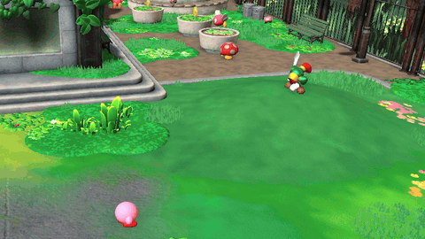<br/><sub><b>BladeKnight 고정형</b></sub></td>
    <td width="50%"><br/><sub><b>BladeKnight 추격형</b></sub></td>
  </tr>
</table>

<details>
<summary><b>세부 구현 사항</b></summary>

- 변종 값 받기
  - 생성할 때 배치 데이터의 변종 문자열을 `Apply_AIVariation`이 AI 타입으로 바꿈
  - Brain이나 전용 상태가 AI 타입을 읽어 행동을 나눔
- BladeKnight 고정형 (`Wait`)
  - 추격하지 않고 제자리에서 공격 · 공격 · 회오리를 돌아가며 사용
- BladeKnight 추격형 (`WaitPursuit`)
  - 가까우면 공격 · 2연속 공격 · 회오리를 돌아가며 쓰고, 멀면 추격
- 같은 방식으로 BrontoBurt · Cappy · NormalEnemy · PoppyBrosJr도 변종에 따라 행동이 갈림

<sub>코드 · [`CBladeKnight::Apply_AIVariation`](https://github.com/ddoichaboom/DX11_3D_GameProject_Team/blob/5cf52376ca5d1a02ebb6c31256e7fa08ef0c6b49/AAA/GameContent/Private/BladeKnight.cpp#L247-L252) · [`CBladeKnight_Brain::Decide_Internal`](https://github.com/ddoichaboom/DX11_3D_GameProject_Team/blob/5cf52376ca5d1a02ebb6c31256e7fa08ef0c6b49/AAA/GameContent/Private/BladeKnight_Brain.cpp#L17-L51) · [`Pick_AttackState`](https://github.com/ddoichaboom/DX11_3D_GameProject_Team/blob/5cf52376ca5d1a02ebb6c31256e7fa08ef0c6b49/AAA/GameContent/Private/BladeKnight_Brain.cpp#L66-L89)</sub>

</details>

### ■ 몬스터 14종

이 구조로 만든 몬스터 14종입니다.<br/>
12종은 전용 판단 · 상태를 갖고, 2종은 공용 상태만으로 동작합니다.

| 분류 | 몬스터 | 특징 |
| --- | --- | --- |
| 근접 · 추격 | BladeKnight | 고정형 · 추격형 변종, 검 공격 · 회오리 |
| | NormalEnemy · NormalEnemyWild | 순찰 · 추격 (NormalEnemy는 표정 애니메이션 이벤트) |
| | Noddy | 감지 시퀀스 |
| 레일 이동 | Kabu | 원작 배치 레일을 따라 이동, 밀려나면 사라졌다 레일 위에 다시 등장 |
| | BrontoBurt | 공중 레일 비행 |
| 투척 · 발사 | PoppyBrosJr | 애니메이션 이벤트로 폭탄을 손 뼈에 붙였다가 던짐 |
| | Dekabu | 애니메이션 이벤트 시점에 KoKabu를 발사 |
| | Gigatzo | 고정 포탑, 코스터 위 표적 예측 발사 |
| 점프 | Bouncy · RabbitEnemy | 점프 이동 |
| 기타 | Cappy | 모자가 분리되는 2단 구조 |
| | SirKibble · RangerEnemy | 공용 상태만으로 동작 |

<table>
  <tr>
    <td width="50%">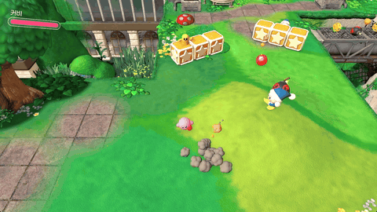<br/><sub><b>PoppyBrosJr</b></sub></td>
    <td width="50%">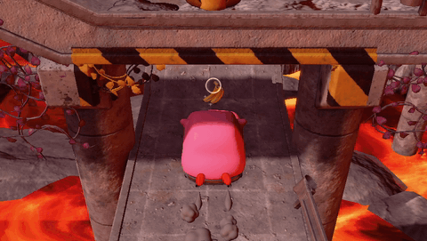<br/><sub><b>Dekabu</b></sub></td>
  </tr>
  <tr>
    <td>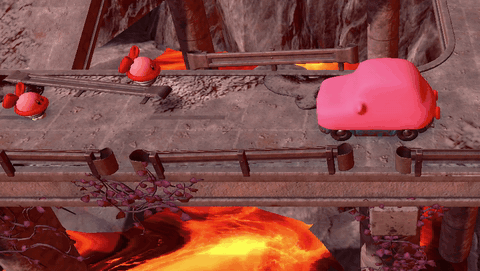<br/><sub><b>Bouncy</b></sub></td>
    <td>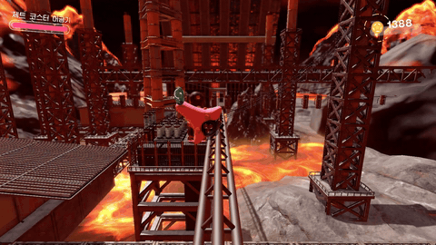<br/><sub><b>Gigatzo</b></sub></td>
  </tr>
</table>

<br/>

## 3. 이동 · 물리

몬스터는 걷기 · 비행 · 레일 등 움직이는 방식이 제각각입니다.<br/>
그래서 **상태는 이동 방향만 요청하고, 실제 이동은 이동 컴포넌트가 맡게** 했습니다.

### ■ PhysX 기반 몬스터 이동 컴포넌트

몬스터 이동은 PhysX 라이브러리를 활용한 자체 엔진 이동 컴포넌트를 상속해 만들었습니다.

- 엔진 이동 컴포넌트
  - 캐릭터 컨트롤러 이동 · 중력 · 접지를 그대로 사용
- 몬스터 이동 컴포넌트 (`CMonster_Movement`)
  - 바라보기(즉시 · 부드럽게 · 고정) · 애니메이션 이동 구간 속도 · 비행 추가
- 회전만 가상 함수로 분리
  - 엔진 이동 함수 안의 회전 코드를 `Apply_Facing`으로 빼고, 몬스터 쪽에서 오버라이드
  - 후퇴처럼 시선을 고정한 채 움직일 때만 회전을 막고, 커비는 기존 회전을 그대로 씀

<sub>코드 · [`CMonster_Movement`](https://github.com/ddoichaboom/DX11_3D_GameProject_Team/blob/5cf52376ca5d1a02ebb6c31256e7fa08ef0c6b49/AAA/GameContent/Public/Monster_Movement.h#L8-L87) · [`CMovement::Apply_Facing`](https://github.com/ddoichaboom/DX11_3D_GameProject_Team/blob/5cf52376ca5d1a02ebb6c31256e7fa08ef0c6b49/AAA/Engine/Private/Movement.cpp#L74-L93) · [`CMonster_Movement::Apply_Facing`](https://github.com/ddoichaboom/DX11_3D_GameProject_Team/blob/5cf52376ca5d1a02ebb6c31256e7fa08ef0c6b49/AAA/GameContent/Private/Monster_Movement.cpp#L273-L279)</sub>

### ■ 레일 이동

레일 몬스터는 원작 배치 데이터의 레일 경로(직선 · 베지어 · 원)를 그대로 따라 이동합니다.<br/>
몬스터 이동 컴포넌트를 상속한 `CMonster_RailMovement`가 경로 위의 진행 거리로 위치를 구합니다.

<table>
  <tr>
    <td width="50%">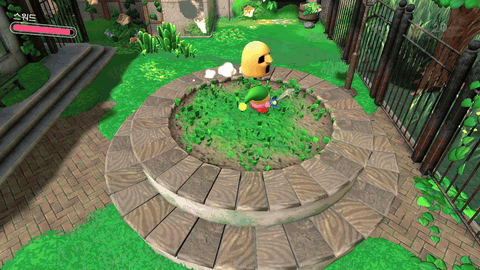<br/><sub><b>Kabu</b></sub></td>
    <td width="50%">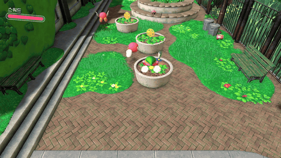<br/><sub><b>BrontoBurt</b></sub></td>
  </tr>
</table>

<details>
<summary><b>세부 구현 사항</b></summary>

#### □ 진행 거리로 위치 찾기

- 진행 거리 누적
  - 매 프레임 진행 거리 s에 `방향 × 속도 × 시간`을 더함
  - 닫힌 경로 · 원은 경로 길이로 감아 돌리고, 열린 경로는 끝에서 반사해 역주행
- 구간 찾기
  - 구간 길이를 차례로 빼 가며 s가 속한 구간과 구간 안 비율 t를 찾음
  - 그 구간을 t로 평가해 위치와 접선을 함께 구함
  - 구간 평가 함수는 레벨 담당의 레일 데이터 클래스를 사용
- 위치 · 방향 반영
  - 위치는 컨트롤러에 동기화하고, 접선 방향을 바라봄 (역주행이면 접선을 뒤집음)

```cpp
m_fPathS += m_iPathDir * m_fPathSpeed * fTimeDelta;          // 진행 거리 누적
if (bLoop)       { while (m_fPathS >= m_fPathLength) m_fPathS -= m_fPathLength; /* 음수도 감음 */ }
else if (m_fPathS > m_fPathLength)                           // 반사
    { m_fPathS = m_fPathLength - (m_fPathS - m_fPathLength); m_iPathDir = -1; }

// Eval_PathPos — s가 속한 구간과 구간 안 비율 찾기
_float rem = fS;
for (_uint i = 0; i < segs; ++i)
{
    CLevelDesign_Rail::Evaluate_Segment(m_tRailDesc, i, 0.f, &a);   // 구간 시작점
    CLevelDesign_Rail::Evaluate_Segment(m_tRailDesc, i, 1.f, &b);   // 구간 끝점
    const _float segLen = sqrtf(dx * dx + dy * dy + dz * dz);        // 두 점의 직선 거리
    if (rem <= segLen || i + 1 == segs)
        return CLevelDesign_Rail::Evaluate_Segment(                // 위치 + 접선
            m_tRailDesc, i, rem / segLen, pOut, pOutTangent);
    rem -= segLen;
}
```

<sub>코드 · [`CMonster_RailMovement::Update_RailFollow`](https://github.com/ddoichaboom/DX11_3D_GameProject_Team/blob/5cf52376ca5d1a02ebb6c31256e7fa08ef0c6b49/AAA/GameContent/Private/Monster_RailMovement.cpp#L45-L103) · [`Eval_PathPos`](https://github.com/ddoichaboom/DX11_3D_GameProject_Team/blob/5cf52376ca5d1a02ebb6c31256e7fa08ef0c6b49/AAA/GameContent/Private/Monster_RailMovement.cpp#L244-L285)</sub>

#### □ 한계와 개선 설계

- 베지어 구간 속도
  - 구간 길이를 두 끝점의 직선 거리로 계산해, 베지어 구간은 속도가 일정하지 않음
  - 원 레일은 둘레를 그대로 써서 정확
- 개선 설계
  - 경로를 별도 리소스 클래스(`CRailTrack`)로 떼고, 호 길이 표로 등속을 맞추는 구조를 설계
  - 클래스 골격까지 적용

</details>

> 엔진 이동 컴포넌트는 팀장이, 레일 구간 평가 함수(`CLevelDesign_Rail`)는 레벨 담당이 만들었습니다.

<br/>

## 4. 게임플레이 기믹

### ■ 메테오

원작의 낙하암(메테오)은 배치마다 떨어지는 위치 · 시작 조건 · 반복 여부가 다릅니다.<br/>
원작 배치 데이터의 값을 그대로 읽어, 배치마다 다른 낙하를 코드 수정 없이 재현했습니다.

<p align="center">
  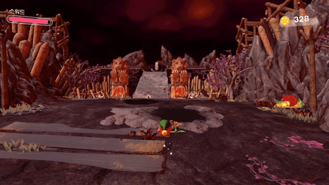
</p>

#### □ 배치 데이터로 정하는 것

<details>
<summary><b>세부 구현 사항</b></summary>

- 경로
  - 낙하 시작점은 배치 데이터에서 읽고, 착지점은 생성기 위치로 둠
- 시작 조건
  - 플레이어가 감지 범위에 들어오거나, 특정 이벤트를 받으면 발사
- 반복
  - 한 번만 떨어지거나 주기마다 반복하고, 이벤트를 받으면 멈추는 설정도 읽음

```cpp
const _string strComp = "Gimmick.VolcanoRock.Builder.MainComponent.";   // 원작 배치 데이터 키
JsonUtils::Try_ReadFloat3Array(jEntry, strComp + "FallStartPosition", &Desc.vFallStart);
JsonUtils::Try_ReadFloat(jEntry, strComp + "FallSpeed", &Desc.fFallSpeed);
JsonUtils::Try_ReadFloat(jEntry, strComp + "IntervalTime", &Desc.fInterval);
JsonUtils::Try_ReadBoolFromNumeric(jEntry, strComp + "IsFallEndOnEventReceive",
                                   &Desc.bFallEndOnEvent);

if (JsonUtils::Try_ReadString(jEntry, strComp + "FallStartType", &strFallStartType))
    Desc.bFindHero = (strFallStartType == L"FindHero");             // 시작 조건: 플레이어 감지
if (JsonUtils::Try_ReadString(jEntry, strComp + "RepeatType", &strRepeatType))
    Desc.bRepeat = (strRepeatType == L"Repeat");                    // 반복
```

<sub>코드 · [`CLD_MeteorGenerator::Build_Desc`](https://github.com/ddoichaboom/DX11_3D_GameProject_Team/blob/5cf52376ca5d1a02ebb6c31256e7fa08ef0c6b49/AAA/GameContent/Private/LD_MeteorGenerator.cpp#L191-L223)</sub>

</details>

#### □ 낙하와 착지

<p align="center">
  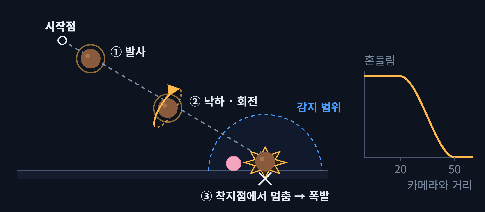
</p>

<details>
<summary><b>세부 구현 사항</b></summary>

- 시작점에서 착지점 방향으로 발사하고, 진행 방향을 축으로 회전하며 낙하
- 한 프레임 이동량이 남은 거리를 넘으면 착지점에 맞춰 멈춰, 지나치지 않음
- 착지하면 판정을 끄고 카메라와의 거리에 따라 흔들림을 준 뒤 폭발 이펙트를 냄

<sub>코드 · [`CLD_MeteorGenerator::Update`](https://github.com/ddoichaboom/DX11_3D_GameProject_Team/blob/5cf52376ca5d1a02ebb6c31256e7fa08ef0c6b49/AAA/GameContent/Private/LD_MeteorGenerator.cpp#L44-L77) · [`CMeteorRock::Update`](https://github.com/ddoichaboom/DX11_3D_GameProject_Team/blob/5cf52376ca5d1a02ebb6c31256e7fa08ef0c6b49/AAA/GameContent/Private/MeteorRock.cpp#L93-L163)</sub>

</details>

### ■ 드랍 별

드랍 별은 능력이 없는 커비가 보스를 공격할 수단으로 쓰는 오브젝트입니다.<br/>
특정 보스의 패턴에서 떨어지고, 커비는 이를 흡입했다가 발사해 보스를 공격합니다.

<table>
  <tr>
    <td width="50%"><br/><sub><b>SWEEP</b></sub></td>
    <td width="50%">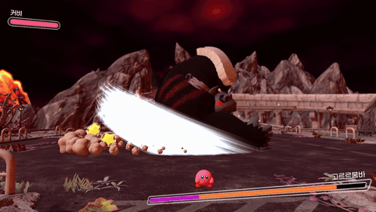<br/><sub><b>흡입 · 발사</b></sub></td>
  </tr>
</table>

#### □ 배치 프리셋

<details>
<summary><b>세부 구현 사항</b></summary>

- 배치 방식
  - SWEEP은 보스 정면 기준 시작 각도부터 호를 따라 차례로, CIRCLE은 원 안에 고르게
  - CIRCLE은 반지름을 `범위 × √난수`로 뽑아 별이 가운데로 몰리지 않게 함
- 프리셋
  - 개수 · 범위 · 시작 각도 · 회전량 · 등장 간격 · 수명을 묶어 보스 3종의 패턴별로 15개 정의
  - 이름 표로 찾으므로, 쓰는 쪽은 프리셋 이름만 넘김

```cpp
enum class STAR_SPAWN_TYPE { SWEEP, CIRCLE };

struct STAR_SPAWN_DESC                                  // 배치 프리셋 하나
{
    STAR_SPAWN_TYPE eType = STAR_SPAWN_TYPE::SWEEP;
    _uint           iCount = { 6 };                     // 별 개수
    _float          fLifeTime = { 3.f };                // 수명
    _float          fDelayStart = { 0.f };              // 첫 별이 나오기까지
    _float          fDelayStep = { 0.08f };             // 별 사이 등장 간격
    _float          fJitter = { 0.5f };                 // 반지름 흔들림 (SWEEP)
    _float3         vLocalOffset = {};                  // 보스 기준 중심
    _float          fRange = { 8.f };                   // 배치 반지름
    _float          fLaunchSpeed = { 0.f };             // 0이면 제자리, 크면 바깥으로 튐
    _float          fStartDeg = { 0.f };                // SWEEP 시작 각도 (정면 기준)
    _float          fSweepDeg = { 90.f };               // SWEEP 총 회전량
};

// 프리셋 예 — 고릴라 오른팔 휩쓸기: 오른쪽 90°에서 반대 방향으로 160° 훑으며 8개
case STAR_SPAWN_PRESET::GORILLA_ARM_SWEEP_RIGHT:
    tSpawnDesc.eType = STAR_SPAWN_TYPE::SWEEP;
    tSpawnDesc.iCount = 8;
    tSpawnDesc.fRange = 15.f;
    tSpawnDesc.fStartDeg = 90.f;
    tSpawnDesc.fSweepDeg = -160.f;
    tSpawnDesc.fDelayStep = 0.15f;
    /* … */
```

<sub>코드 · [`STAR_SPAWN_DESC`](https://github.com/ddoichaboom/DX11_3D_GameProject_Team/blob/5cf52376ca5d1a02ebb6c31256e7fa08ef0c6b49/AAA/GameContent/Public/DropStar_Manager.h#L19-L59) · [`CDropStar_Manager::Get_Preset`](https://github.com/ddoichaboom/DX11_3D_GameProject_Team/blob/5cf52376ca5d1a02ebb6c31256e7fa08ef0c6b49/AAA/GameContent/Private/DropStar_Manager.cpp#L140-L173)</sub>

```cpp
if (Desc.eType == STAR_SPAWN_TYPE::CIRCLE)
{
    _float fR = Desc.fRange * sqrtf(RandomFloat(0.f, 1.f));    // 면적에 균일
    _float fAngle = RandomFloat(0.f, XM_2PI);
    XMScalarSinCos(&fSin, &fCos, fAngle);
    return vCenter + XMVectorSet(1.f, 0.f, 0.f, 0.f) * (fR * fCos)
                   + XMVectorSet(0.f, 0.f, 1.f, 0.f) * (fR * fSin);
}
// SWEEP : Look 기준 시작 각도부터 호를 따라 균등 배치 + 약간의 흔들림
_float fDeg = Desc.fStartDeg + fT * Desc.fSweepDeg;                  // fT = iIndex / (iCount - 1)
_matrix matRot = XMMatrixRotationAxis(XMVectorSet(0.f, 1.f, 0.f, 0.f), XMConvertToRadians(fDeg));
_vector vDir = XMVector3Normalize(XMVector3TransformNormal(vLook, matRot));
// fJitter = RandomFloat(-Desc.fJitter, Desc.fJitter)
return vCenter + vDir * (Desc.fRange + fJitter);
```

<sub>코드 · [`CDropStar_Manager::Compute_StarPos`](https://github.com/ddoichaboom/DX11_3D_GameProject_Team/blob/5cf52376ca5d1a02ebb6c31256e7fa08ef0c6b49/AAA/GameContent/Private/DropStar_Manager.cpp#L380-L407)</sub>

</details>

#### □ 애니메이션 이벤트로 연결

<p align="center">
  
</p>

<details>
<summary><b>세부 구현 사항</b></summary>

- 이벤트
  - 보스 클립의 DropStars 이벤트에 프리셋 이름과 오프셋을 넣음
  - 그 시점에 보스 위치 · 방향 기준으로 프리셋대로 별을 배치
- 툴
  - AnimUITool에서 이벤트를 넣고 프리뷰로 배치를 바로 확인

```cpp
if (static_cast<EANIM_EVENT>(e.iEventType) != EANIM_EVENT::DropStars)
    return false;
if (ePhase != ANIM_EVENT_PHASE::POINT)
    return true;
const _wstring strSpawnType = StrToWstr(e.strParam);           // 이벤트에 적은 프리셋 이름
CDropStar_Manager::GetInstance()->Spawn_Preset(Get_LevelIndex(),  // 보스 위치 · 방향 기준
    XMLoadFloat4x4(m_pTransformCom->Get_WorldMatrixPtr()), strSpawnType, e.vOffset);
```

<sub>코드 · [`CBossBase::Handle_DropStarsAnimEvent`](https://github.com/ddoichaboom/DX11_3D_GameProject_Team/blob/5cf52376ca5d1a02ebb6c31256e7fa08ef0c6b49/AAA/GameContent/Private/BossBase.cpp#L174-L190)</sub>

</details>

#### □ 오브젝트 풀

<details>
<summary><b>세부 구현 사항</b></summary>

- 재사용
  - 다 쓴 별은 지우지 않고 비활성화해 대기 목록으로 돌림
  - 다음 패턴에서는 대기 목록에서 꺼내 위치 · 수명만 다시 설정
- 생성
  - 대기 목록이 비었을 때만 새로 만들고, 모델 · 원형은 시작할 때 한 번만 올려 둠
  - 레벨이 바뀌면 그 레벨의 대기 목록을 비움

</details>

### ■ 능력 방울

능력 방울은 커비가 닿거나 흡입해 복사 능력을 얻는 오브젝트입니다.<br/>
받침대 위의 습득용 방울과 커비가 버린 방울을 나눠 설계하고, 하나의 풀로 관리했습니다.

#### □ 받침대 방울

<p align="center">
  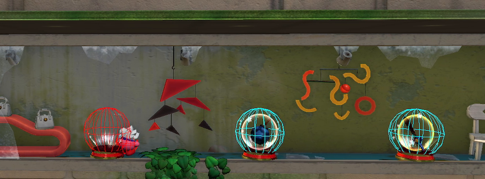
</p>

<details>
<summary><b>세부 구현 사항</b></summary>

- 생성
  - 받침대가 배치 데이터의 능력 이름(Sword · Bomb · Ice …)을 능력 종류로 바꿈
  - 받침대 모델의 소켓 뼈 행렬에 월드 행렬을 곱해 위치를 구하고, 그 자리에 풀에서 꺼냄
- 숨김 · 다시 나타나기
  - 방울을 지우지 않고, 커비가 콜라이더에 들어오면 렌더링을 끄고 획득 불가로 바꿈
  - 커비가 나가면 2초 타이머를 걸고, 끝나면 다시 보이며 획득 가능

</details>

#### □ 버린 방울

<p align="center">
  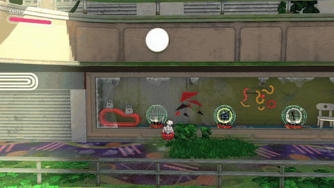
</p>

<details>
<summary><b>세부 구현 사항</b></summary>

- 떠다니기
  - 매 프레임 속도에 중력과 주기가 다른 두 축 흔들림을 더하고, 공기 저항 비율만큼 줄임
  - PhysX 컨트롤러로 이동하고, 바닥에 닿으면 위쪽 속도를 다시 줘 떠 있게 함
- 흡입 · 밀림
  - 흡입되면 콜라이더 · 컨트롤러를 끄고, 커비 입 쪽으로 가속하며 작아지다 삼켜짐
  - 흡입이 아닐 때 커비와 겹치면 커비 반대쪽으로 수평 속도를 줘 밀어냄
- 수명
  - 10초가 지나면 컴포넌트를 끄고 풀로 돌아감

```cpp
m_vVelocity.y += s_fGravity * fTimeDelta;                       // 약한 중력
m_fBobPhase += fTimeDelta;
_float fSwayT = m_fBobPhase * s_fSwayFreq;
_float fStep = s_fSwayAccel * fTimeDelta;
m_vVelocity.x += fStep * sinf(fSwayT);                          // 두 축 흔들림 (주기를 다르게)
m_vVelocity.z += fStep * cosf(fSwayT * 0.77f);
_float k = 1.f - s_fAirDrag * fTimeDelta;                       // 공기 저항
m_vVelocity.x *= k;
m_vVelocity.y *= k;
m_vVelocity.z *= k;

_vector vDisp = XMLoadFloat3(&m_vVelocity) * fTimeDelta;
_uint iFlags = m_pController->Move(vDisp, 0.001f, fTimeDelta);  // PhysX 컨트롤러로 이동
if ((iFlags & PXCF::eCOLLISION_DOWN) && m_vVelocity.y < 0.f)
    m_vVelocity.y = s_fHoverKick;                               // 바닥에 닿으면 다시 띄움
```

<sub>코드 · [`CDroppedBubble::Update_Movement`](https://github.com/ddoichaboom/DX11_3D_GameProject_Team/blob/5cf52376ca5d1a02ebb6c31256e7fa08ef0c6b49/AAA/GameContent/Private/DroppedBubble.cpp#L244-L288)</sub>

</details>

#### □ 공통 구조와 오브젝트 풀

<details>
<summary><b>세부 구현 사항</b></summary>

- 공통 베이스 (`CAbility_Bubble`)
  - 능력 모델 파츠 · 구 콜라이더 · 오라 이펙트 · 풀 연결을 공통으로 가짐
  - 풀에서 꺼낼 때마다 위치 · 크기 · 상태를 초기화
  - 충돌 레이어와 충돌 반응 · 움직임만 파생 클래스가 정함
- 충돌 레이어 분리
  - 두 방울을 서로 다른 충돌 레이어로 등록해, 커비 쪽은 레이어만 보고 획득 · 흡입을 구분
- 오브젝트 풀
  - 방울 종류 + 능력 종류를 키로 대기 목록을 두고, 비었을 때만 새로 만듦
  - 커비 코드는 방울 클래스를 모른 채, 생성 함수에 종류 · 능력 · 위치 · 방향만 넘김

```cpp
const _wstring strKey = Make_Key(eKind, eAbility);                // 방울 종류 + 능력 종류
auto it = m_Dormant.find(POOL_KEY{ iTargetLevel, strKey });
if (it != m_Dormant.end() && !it->second.empty())                 // 대기 목록에서 꺼내 재사용
{
    CAbility_Bubble* p = it->second.back();
    it->second.pop_back();
    p->Activate(vPos);
    p->Launch(vDir);                                              // 버린 방울만 던질 방향 사용
    return S_OK;
}
desc.szModelProtoTag = Model_Of(eAbility);                        // 비었을 때만 생성, 능력별 모델
m_pGameInstance_Proxy->Add_GameObject_Return(&pObj, ETOUI(LEVEL::STATIC), Proto_Of(eKind),
                                             iTargetLevel, BUBBLE_LAYER_TAG, strTag, &desc);
pBubble->Set_Pool(this, iTargetLevel, strKey);
```

<sub>코드 · [`CBubble_Manager::Spawn`](https://github.com/ddoichaboom/DX11_3D_GameProject_Team/blob/5cf52376ca5d1a02ebb6c31256e7fa08ef0c6b49/AAA/GameContent/Private/Bubble_Manager.cpp#L100-L135)</sub>

</details>

<br/>

## 5. 사운드

팀 프레임워크의 FMOD 사운드 매니저 위에, 재생 중인 소리를 다루는 기능과 믹싱을 더했습니다.<br/>
이를 바탕으로 몬스터 소리와 구역 환경음 · BGM을 연결했습니다.

### ■ 사운드 핸들

재생을 요청한 쪽이 FMOD 채널 포인터를 직접 들고 있으면, 이미 끝난 소리를 건드릴 수 있습니다.<br/>
그래서 채널을 감싼 값 타입 핸들(`CSound_Handle`)로만 정지 · 볼륨 · 일시정지를 다루게 했습니다.

<details>
<summary><b>세부 구현 사항</b></summary>

- 값 타입
  - 복사해 들고 다닐 수 있고, 소멸자에서 자동으로 멈추지 않아 멈출 때를 쓰는 쪽이 정함
  - 모든 호출 전에 널 · 반환값을 검사하고, `Stop`은 재생 중일 때만 멈춘 뒤 핸들을 비움
- 루프 해제
  - `Release_Loop`는 루프 모드만 꺼서, 반복 중인 소리를 끝까지 재생하고 끝냄

```cpp
class ENGINE_DLL CSound_Handle final                // 재생 중인 채널을 감싼 값 타입 (복사 가능)
{
public:
    CSound_Handle() = default;
    explicit CSound_Handle(FMOD::Channel* pChannel);

    void    Stop();                                 // 재생 중이면 멈추고 핸들을 비움
    void    Release_Loop();                         // 루프만 꺼서 끝까지 재생 후 종료
    void    Set_Paused(_bool bPause);
    void    Set_Volume(_float fVolume);
    _bool   Is_Playing() const;
    _bool   Is_Valid() const { return nullptr != m_pChannel; }
private:
    FMOD::Channel* m_pChannel = { nullptr };        // 소멸자에서 자동으로 멈추지 않음
};
```

<sub>코드 · [`CSound_Handle`](https://github.com/ddoichaboom/DX11_3D_GameProject_Team/blob/5cf52376ca5d1a02ebb6c31256e7fa08ef0c6b49/AAA/Engine/Public/Sound_Handle.h#L12-L32)</sub>

</details>

### ■ 구간 반복 · BGM 페이드

시작음 · 반복부 · 마무리음이 한 파일에 든 소리는 가운데만 반복하고,<br/>
BGM 페이드는 매 프레임 볼륨을 바꾸지 않고 FMOD 믹서의 시각에 맡겼습니다.

<details>
<summary><b>세부 구현 사항</b></summary>

- 구간 반복
  - 클립 길이에 대한 0 ~ 1 비율로 시작 · 끝을 받아 FMOD 루프 지점(ms)으로 바꿈
  - 끝낼 때 루프를 풀면 마무리음까지 재생하고 끝남
- BGM 페이드
  - FMOD DSP 클럭에 페이드 시작 · 끝 지점을 찍음
  - 믹서가 그 사이를 샘플 단위로 줄이거나 키우고, 페이드 아웃이 끝나는 클럭에 정지를 예약
  - 같은 BGM이 이미 재생 중이면 처음부터 다시 틀지 않음

```cpp
unsigned long long iDspClock = 0;
pChannel->getDSPClock(nullptr, &iDspClock);                         // 지금 믹서 시각 (샘플)
unsigned long long iFadeSamples = (unsigned long long)((double)iSampleRate * fSeconds);

pChannel->removeFadePoints(0, ~0ull);
pChannel->addFadePoint(iDspClock, fFrom);                           // 지금 → fFrom
pChannel->addFadePoint(iDspClock + iFadeSamples, fTo);              // fSeconds 뒤 → fTo
if (bStopAtEnd)
    pChannel->setDelay(0, iDspClock + iFadeSamples, true);          // 페이드가 끝나는 시각에 정지
```

<sub>코드 · [`CSound_Manager::Fade_BGM_Channel`](https://github.com/ddoichaboom/DX11_3D_GameProject_Team/blob/5cf52376ca5d1a02ebb6c31256e7fa08ef0c6b49/AAA/Engine/Private/Sound_Manager.cpp#L405-L433)</sub>

</details>

### ■ 믹싱

여러 소리가 한꺼번에 날 때 지나치게 커지거나, 중요한 소리가 밀리지 않게 세 가지를 두었습니다.

<details>
<summary><b>세부 구현 사항</b></summary>

- 같은 소리 중첩 제한
  - 같은 효과음이 60ms 안에 몰리면 3번까지만 재생하고, 겹칠 때마다 볼륨을 0.6배씩 낮춤
  - 건너뛴 요청은 시각을 갱신하지 않아, 마지막 재생에서 60ms 뒤면 다시 재생
  - 루프 · BGM은 빼고 단발 효과음에만 적용
- 마스터 리미터
  - 마스터 버스에 FMOD 리미터를 걸어, 합쳐진 출력이 −0.5dB를 넘지 않게 함
- 채널 우선순위
  - 버스별 우선순위를 BGM > 환경음 > UI > 음성 > 효과음 순으로 줌
  - 채널이 모자라면 효과음부터 밀려남

```cpp
SOUND_GATE& Gate = m_mapSoundGate[pSound];                // 사운드별 기록
if (ullNow - Gate.ullLastMs > SOUND_GATE_WINDOW_MS)
    Gate.iBurst = 0;                                      // 창이 지나면 초기화
if (Gate.iBurst >= SOUND_GATE_MAX_STACK)
    return false;                                         // 건너뜀 (시각 갱신 안 함)
Gate.ullLastMs = ullNow;
++Gate.iBurst;
for (_uint i = 1; i < Gate.iBurst; ++i)
    fVolume *= SOUND_GATE_FALLOFF;                        // 겹칠수록 작게
return true;
```

<sub>코드 · [`CSound_Manager::Gate_Sound`](https://github.com/ddoichaboom/DX11_3D_GameProject_Team/blob/5cf52376ca5d1a02ebb6c31256e7fa08ef0c6b49/AAA/Engine/Private/Sound_Manager.cpp#L86-L105)</sub>

</details>

### ■ 몬스터 사운드

몬스터 소리는 성격에 따라 재생하는 곳을 나눴습니다.

<p align="center">
  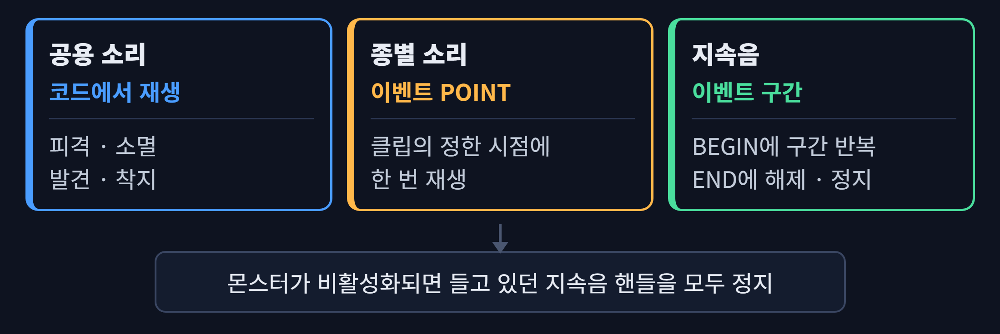
</p>

<details>
<summary><b>세부 구현 사항</b></summary>

- 공용 소리
  - 피격(공격 종류별) · 소멸 · 발견 · 착지처럼 모든 몬스터가 같은 소리
  - 몬스터 베이스 · 공용 상태 코드에서 재생
- 종별 소리 · 지속음
  - 애니메이션 사운드 이벤트의 POINT에서 한 번 재생
  - 구간 이벤트는 BEGIN에 구간 반복, END에 루프 해제나 정지
  - 지속음 핸들은 사운드 이름별 맵에 두고, 몬스터가 비활성화되면 한꺼번에 정지

```cpp
const _wstring strSound = StrToWstr(e.strParam);
if (e.bIsRange)                                                     // 구간 이벤트 — 지속음
{
    if (ePhase == ANIM_EVENT_PHASE::BEGIN)
        Play_SectionLoopSFX(strSound.c_str(), e.vOffset.x, e.vOffset.y, e.vOffset.z);  // 구간 반복
    else if (ePhase == ANIM_EVENT_PHASE::END)
    {
        if (e.iIntParam == 0)   Release_LoopSFX(strSound.c_str());   // 루프 해제 — 끝까지 재생
        else                    Stop_LoopSFX(strSound.c_str());      // 바로 정지
    }
    return true;
}
if (ePhase == ANIM_EVENT_PHASE::POINT)                              // 한 점 이벤트 — 한 번 재생
    m_pGameInstance_Proxy->Play_SFX3D(strSound.c_str(), vPos, e.vOffset.x);
```

<sub>코드 · [`CMonster::Handle_SoundAnimEvent`](https://github.com/ddoichaboom/DX11_3D_GameProject_Team/blob/5cf52376ca5d1a02ebb6c31256e7fa08ef0c6b49/AAA/GameContent/Private/Monster.cpp#L617-L659)</sub>

</details>

### ■ 구역 환경음 · BGM 구역

구역 오브젝트(트리거 · 배치 데이터 파싱 · 매핑 표 구조)는 레벨 담당이 만들었습니다.<br/>
그 위에 구역마다 소리를 고르고 재생하는 **재생 로직**을 구현했습니다.

#### □ 구역 연결

<details>
<summary><b>세부 구현 사항</b></summary>

- 매핑
  - 원작 배치 데이터의 구역 이름 · 변종 값으로 매핑 표를 찾아 사운드 · 볼륨 등을 읽음
  - 매핑 표에 감쇠 거리 항목을 추가
  - BGM 구역 1종과 정글 · 파도 · 용암 폭포 · 마을 등 환경음 12종을 연결
- 누락 구역
  - 원작 데이터에는 있지만 생성되지 않던 구역 4종을 등록
  - 수도관 · 용암 폭포 · 모래 폭포 · 월드맵

</details>

#### □ 환경음 볼륨

<p align="center">
  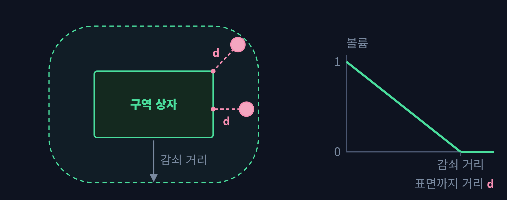
</p>

<details>
<summary><b>세부 구현 사항</b></summary>

- 거리 계산
  - 축마다 중심과의 거리에서 상자 반 크기를 빼(안쪽이면 0) 표면까지 거리 d를 구함
  - 볼륨은 d가 감쇠 거리에 가까워질수록 선형으로 줄임
- 재생 유지
  - 볼륨 0으로 루프 재생을 시작해 두고, 매 프레임 핸들의 볼륨만 바꿈
  - 구역을 오가도 소리가 끊기거나 처음부터 다시 나오지 않음

```cpp
vSurfaceDist.x = max(fabsf(vPlayerPos.x - vAreaCenter.x) - vHalfSize.x, 0.f);   // 안쪽이면 0
vSurfaceDist.y = max(fabsf(vPlayerPos.y - vAreaCenter.y) - vHalfSize.y, 0.f);
vSurfaceDist.z = max(fabsf(vPlayerPos.z - vAreaCenter.z) - vHalfSize.z, 0.f);
const _float fDistToArea = sqrtf(vSurfaceDist.x * vSurfaceDist.x + vSurfaceDist.y * vSurfaceDist.y
                               + vSurfaceDist.z * vSurfaceDist.z);
const _float fAttenRatio = max(0.f, 1.f - fDistToArea / fFalloffRange);
m_AmbientHandle.Set_Volume(pBinding->fVolume * fAttenRatio);                    // 핸들 유지, 볼륨만
```

<sub>코드 · [`CLD_AudioArea::Update_Proximity`](https://github.com/ddoichaboom/DX11_3D_GameProject_Team/blob/5cf52376ca5d1a02ebb6c31256e7fa08ef0c6b49/AAA/GameContent/Private/LD_AudioArea.cpp#L341-L401)</sub>

</details>

#### □ BGM 구역

<details>
<summary><b>세부 구현 사항</b></summary>

- 트랙 연결
  - 구역의 사운드 번호가 스테이지 BGM 목록의 인덱스임을 원작 맵 데이터에서 확인
  - 그 번호로 해당 트랙을 연결
- 진입 · 이탈
  - 들어가면 원작 데이터의 페이드 인 프레임만큼 키우고, 나가면 비활성 프레임만큼 줄임
  - 다 줄어들면 정지하지 않고 일시정지해, 다시 들어오면 멈췄던 위치부터 이어서 재생

<sub>코드 · [`CLD_AudioArea::Request_BGM`](https://github.com/ddoichaboom/DX11_3D_GameProject_Team/blob/5cf52376ca5d1a02ebb6c31256e7fa08ef0c6b49/AAA/GameContent/Private/LD_AudioArea.cpp#L300-L327) · [`Update_BgmFadeOut`](https://github.com/ddoichaboom/DX11_3D_GameProject_Team/blob/5cf52376ca5d1a02ebb6c31256e7fa08ef0c6b49/AAA/GameContent/Private/LD_AudioArea.cpp#L403-L428)</sub>

</details>

#### □ 거리 기반으로 통일한 이유

<details>
<summary><b>세부 구현 사항</b></summary>

- 구역 상자의 범위
  - 정글 구역 상자가 정글 전체가 아니라 소리가 나는 일부만 덮고 있었음
  - 그래서 상자를 음원 영역으로 보고, 밖에서도 거리에 따라 들리게 함
- 감쇠 거리
  - 원작 데이터에 없어 설계값으로 정함
  - 정글 · 파도 감쇠 거리의 합(50 + 40 = 90)이 두 구역 간격(84.5) 이상이 되게 함

</details>

<br/>

## 6. 렌더링 · 셰이더

렌더러와 셰이더 구조는 팀 엔진 프레임워크의 것을 그대로 썼습니다.<br/>
그 위에 몬스터 · 폭탄에 필요한 부분만 더해 활용했습니다.

### ■ 디더링 페이드

컬링 거리 앞에서 몬스터가 갑자기 사라지지 않도록, 원작처럼 디더링으로 서서히 사라지게 했습니다.

<details>
<summary><b>세부 구현 사항</b></summary>

- 활용한 것
  - 거리에 따른 페이드 값은 엔진 컬링 매니저(레벨 담당)가 계산
  - 몬스터가 그 값을 받아 셰이더에 넘김
  - 몬스터 셰이더(팀장)는 그대로 두고, 디더 함수만 더해 모든 픽셀 셰이더 패스에서 호출
- 디더 방식
  - 알파 블렌딩 대신 4×4 Bayer 행렬의 문턱값과 비교해 픽셀을 버림(`discard`)
  - 정렬이 필요 없고, 남은 픽셀은 깊이 버퍼에도 그대로 쓰임
  - 화면 좌표의 하위 2비트로 칸을 골라, 사라지는 정도가 커질수록 더 많은 칸이 비게 함

```hlsl
static const float Bayer4x4[16] = { 0/16., 8/16., 2/16., 10/16., 12/16., 4/16., 14/16., 6/16.,
                                    3/16., 11/16., 1/16., 9/16., 15/16., 7/16., 13/16., 5/16. };
void Apply_Dither(float4 vScreenPos, float fDissolve)
{
    [branch] if (fDissolve <= 0.0001f) return;
    float fVisibility = 1.f - saturate(fDissolve);
    int2 px = int2(vScreenPos.xy) & 3;                  // 화면 좌표 → 4×4 칸
    if (fVisibility <= Bayer4x4[px.y * 4 + px.x])
        discard;
}
```

<sub>코드 · [`Apply_Dither`](https://github.com/ddoichaboom/DX11_3D_GameProject_Team/blob/5cf52376ca5d1a02ebb6c31256e7fa08ef0c6b49/AAA/GameContent/ShaderFiles/Shader_Monster.hlsl#L30-L49)</sub>

</details>

### ■ 폭탄 도화선 셰이더

폭탄이 터지기 전 도화선이 타 들어가는 모습을 전용 셰이더로 표현했습니다.

<details>
<summary><b>세부 구현 사항</b></summary>

- 활용한 것
  - 팀 디퍼드 렌더러의 G-버퍼 출력 형식과 스키닝 · 그림자 패스 구조를 그대로 따름
  - 폭탄에 필요한 몸체 · 도화선 픽셀 셰이더만 새로 작성
- 도화선
  - 텍스처 좌표의 세로 값이 타 들어간 정도보다 작은 부분을 `clip`으로 잘라 냄
  - 경계 근처는 `smoothstep`으로 그을린 색을 섞음
  - 바로 경계는 발광 색을 더해 불씨처럼 보이게 함
  - 타 들어간 정도는 도화선 애니메이션 레이어의 진행도를 그대로 써, 1이 되면 폭발
- 몸체
  - 위험 경고 클립의 애니메이션 이벤트가 정한 색으로 몸체를 발광시켜 깜박임

```hlsl
float fBurn = In.vTexcoord.y;                                   // 도화선을 따라 0 → 1
clip(fBurn - g_fBurnRatio);                                     // 이미 탄 부분은 잘라 냄

float fChar = smoothstep(g_fBurnRatio, g_fBurnRatio + 0.15f, fBurn);
vAlbedo *= lerp(0.2f, 1.f, fChar);                              // 경계 근처는 그을린 색

float fEmber = 1.f - smoothstep(g_fBurnRatio, g_fBurnRatio + 0.05f, fBurn);
Out.vEmissive = float4(g_vEmissiveColor.rgb + float3(1.f, 0.35f, 0.05f) * fEmber, 1.f);  // 불씨
```

<sub>코드 · [`PS_FUSE`](https://github.com/ddoichaboom/DX11_3D_GameProject_Team/blob/5cf52376ca5d1a02ebb6c31256e7fa08ef0c6b49/AAA/GameContent/ShaderFiles/Shader_Bomb.hlsl#L178-L219)</sub>

</details>

<br/>

## 7. 최적화

### ■ 거리 기반 애니메이션 갱신 주기 · 위상 분산

멀리 있어 잘 보이지 않는 몬스터까지 매 프레임 뼈 애니메이션을 계산할 필요는 없었습니다.<br/>
카메라와의 거리에 따라 **애니메이션을 몇 프레임마다 갱신할지 정하는 로직**을 만들었습니다.<br/>
렌더 컬링과 거리 페이드 계산은 레벨 담당의 컬링 틀을 그대로 활용했습니다.

| 카메라 ~ 몬스터 표면 거리 | 애니메이션 갱신 | 60fps 기준 |
| --- | --- | ---: |
| 65 미만 | 매 프레임 | 초당 60회 |
| 65 ~ 80 | 2프레임마다 | 초당 30회 |
| 80 이상 (화면에 보이는 범위) | 4프레임마다 | 초당 15회 |
| 컬링 거리 밖 (렌더 제외) | 8프레임마다 | 초당 7.5회 |

#### □ 거리별 갱신 주기

<p align="center">
  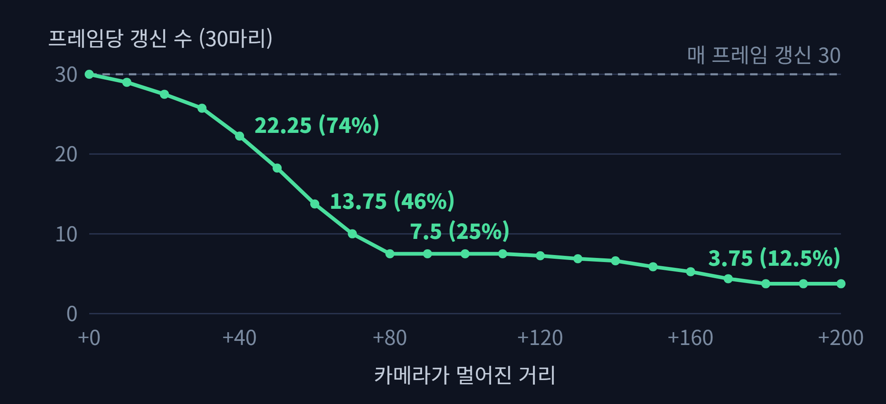
</p>

<details>
<summary><b>세부 구현 사항</b></summary>

- 판단은 몬스터 단위로 한 번
  - 몬스터 본체가 매 프레임 거리 구간 → 주기 → 이번 프레임이 갱신 차례인지를 계산해 기록
  - 몸체 · 모자 같은 파츠는 그 값만 읽어, 파츠끼리 뼈가 어긋나지 않음
- 렌더에서 빠져도 멈추지 않음
  - 완전히 멈추면 애니메이션 종료를 기다리는 상태가 멈추고 레일 몬스터의 이벤트가 끊김
  - 그래서 컬링 거리 밖에서도 8프레임 주기로 계속 진행
- 결과 (시뮬레이션)
  - 프레임 시간 대신, 같은 판단 로직의 시뮬레이션으로 갱신 호출 수를 비교
  - 카메라 앞 30마리에서 카메라가 멀어질수록 평균 갱신 수가 25% · 12.5%까지 줄어듦

<sub>시뮬레이션 · [`uro_sim.py`](docs/uro_sim.py)</sub>

</details>

#### □ 건너뛴 시간 누적

갱신하지 않은 프레임을 그냥 건너뛰면, 애니메이션이 끊기거나 느려집니다.<br/>
그래서 건너뛴 시간을 쌓아 두었다가, 갱신하는 프레임에 한 번에 넘겼습니다.

<details>
<summary><b>세부 구현 사항</b></summary>

- 진행 속도 유지
  - 4프레임 주기면 4프레임 분량을 한 번에 진행해, 갱신 횟수만 줄고 진행 속도는 그대로
  - 누적하지 않으면 4프레임 주기에서 1/4 배속이 되고, AI 타이머와도 어긋남

```cpp
const _uint iPeriod = Calc_AnimPeriod(tFade.fBoundaryDistance);    // 거리 구간 → 주기 1 · 2 · 4 · 8
m_fAnimAccum += fTimeDelta;                                         // 이번 프레임 시간 누적
++m_iCullFrame;
m_CullState.bAnimTick = (iPeriod <= 1)
    || (0 == ((m_iCullFrame + m_iCullPhase) % iPeriod));            // 몬스터마다 위상을 어긋나게
if (m_CullState.bAnimTick)
{
    m_CullState.fAnimDt = m_fAnimAccum;                             // 건너뛴 시간을 한 번에 전달
    m_fAnimAccum = 0.f;
}
```

<sub>코드 · [`CMonster::Update_CullGrade`](https://github.com/ddoichaboom/DX11_3D_GameProject_Team/blob/5cf52376ca5d1a02ebb6c31256e7fa08ef0c6b49/AAA/GameContent/Private/Monster.cpp#L555-L605)</sub>

</details>

#### □ 갱신 시점 분산

주기만 나누면 같은 주기의 몬스터가 같은 프레임에 몰려, 그 프레임만 무거워집니다.<br/>
몬스터마다 갱신하는 프레임을 흩어 두는 편이 고르다고 보고, 시작 위상을 나눴습니다.

<p align="center">
  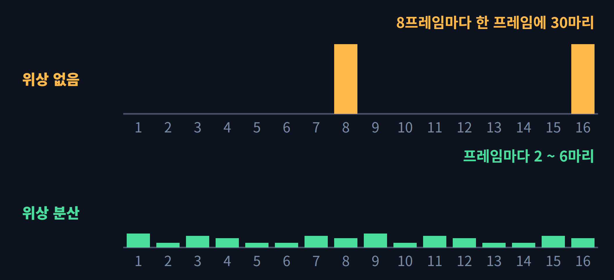
</p>

<details>
<summary><b>세부 구현 사항</b></summary>

- 시작 위상
  - 생성할 때 위상(0 ~ 7)을 무작위로 정함
  - 같은 거리 · 같은 주기여도 몬스터마다 갱신 프레임이 서로 다름
- 결과 (시뮬레이션)
  - 30마리가 모두 8프레임 주기일 때, 위상이 없으면 8프레임마다 한 프레임에 30마리가 몰림
  - 위상을 나누면 프레임마다 2 ~ 6마리로 고르게 분산

</details>

<br/>

## 8. 툴 · 리소스 파이프라인

### ■ ImGui 활용 제작 툴 (AnimUITool)

애니메이션 이벤트를 타임라인 위에서 배치하고 바로 재생해 보려고 만든 ImGui 툴입니다.<br/>
게임과 같은 엔진 위에서 돌아가, 툴에서 맞춘 결과가 게임에서도 그대로 동작합니다.

<p align="center">
  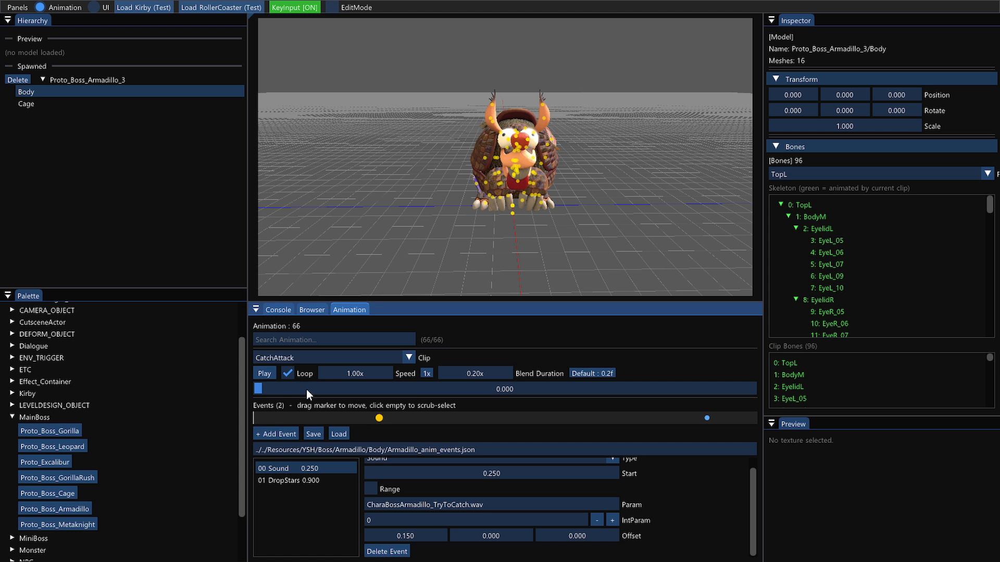
</p>

#### □ 패널 매니저와 편집 컨텍스트

<details>
<summary><b>세부 구현 사항</b></summary>

- 패널 구조
  - 모든 패널은 같은 베이스(`CPanel`)를 상속함
  - 패널 매니저가 패널을 이름으로 등록하고, 갱신 · 그리기를 맡음
  - 작업 모드(애니메이션 · UI)를 바꾸면 그 모드에 필요한 패널만 갱신하고 그림
- 편집 컨텍스트
  - 선택한 객체 · 모델 · Animator · 클립 · 진행도 · 고른 본을 매니저의 컨텍스트 하나에 둠
  - 패널은 그 값을 읽고 고치기만 해, 패널끼리 상태가 어긋나지 않음
  - 선택한 객체는 참조를 잡아 두고, 지워진 객체를 가리키면 매 프레임 검사해 선택을 풂

```cpp
typedef struct tagAnimContext                          // 패널들이 함께 보는 편집 상태
{
    CGameObject*    pOwner = { nullptr };               // 선택한 객체 (파츠일 수도 있음)
    CModel*         pModel = { nullptr };
    CAnimator*      pAnimator = { nullptr };
    _wstring        strModelPath = {};                  // 이벤트 JSON 경로를 만들 때 사용
    _int            iClip = { 0 };
    _bool           bPlaying = { true };
    _float          fProgress = { 0.f };                // 0 ~ 1 진행도
    _float          fPlaySpeed = { 1.f };
    _float          fBlendDuration = { 0.2f };
    _int            iSelBone = { -1 };                  // Inspector · Viewport가 함께 강조
    _bool           Valid() const { return pModel && pAnimator; }
}ANIM_CONTEXT;
```

<sub>코드 · [`ANIM_CONTEXT`](https://github.com/ddoichaboom/DX11_3D_GameProject_Team/blob/5cf52376ca5d1a02ebb6c31256e7fa08ef0c6b49/AAA/AnimUITool/Public/AnimUITool_Struct.h#L21-L42)</sub>

</details>

#### □ 패널 구성

| 패널 | 하는 일 |
| --- | --- |
| Browser | Resources 폴더 탐색, `.ysh` 더블클릭으로 모델 불러오기, 파일을 끌어 다른 패널에 놓기 |
| Preview | Browser에서 고른 텍스처를 패널 크기에 맞춰 미리 보기 |
| Hierarchy | 생성한 객체와 파츠를 트리로 표시, 고른 파츠의 Animator를 편집 대상으로 연결 |
| Inspector | 위치 · 회전 · 크기, 메시 표시, 셰이더 · 패스 강제, 본 트리 |
| Viewport | 장면을 그린 텍스처를 비율을 지켜 표시하고, 본 위치를 점으로 겹쳐 그림 |
| Console | 정보 · 경고 · 오류를 골라 보기, 맨 아래를 볼 때만 자동 스크롤 |
| Palette | 오브젝트 팩토리에 등록된 객체를 분류별 버튼으로 생성 |
| Animation | 클립 재생 · 이벤트 타임라인 |

#### □ 모델 확인

<details>
<summary><b>세부 구현 사항</b></summary>

- 불러오기
  - Browser에서 `.ysh`를 더블클릭하면 미리보기 객체로 불러와 편집 컨텍스트에 연결
- 메시 · 셰이더
  - 메시별 켜기 · 끄기 · 하나만 보기로 문제 있는 메시를 찾음
  - 셰이더(애니 메시 · 일반 메시)와 패스를 강제로 바꿔, 머티리얼 문제와 모델 문제를 구분
  - 커비 표정(몸 · 입 · 눈)은 상태 이름 드롭다운으로 바로 바꿔 봄

<sub>코드 · [`CPanel_Browser`](https://github.com/ddoichaboom/DX11_3D_GameProject_Team/blob/5cf52376ca5d1a02ebb6c31256e7fa08ef0c6b49/AAA/AnimUITool/Private/Panel_Browser.cpp#L112-L153) · [`Render_Meshs`](https://github.com/ddoichaboom/DX11_3D_GameProject_Team/blob/5cf52376ca5d1a02ebb6c31256e7fa08ef0c6b49/AAA/AnimUITool/Private/Panel_Inspector.cpp#L553-L636) · [`Render_RenderDebug`](https://github.com/ddoichaboom/DX11_3D_GameProject_Team/blob/5cf52376ca5d1a02ebb6c31256e7fa08ef0c6b49/AAA/AnimUITool/Private/Panel_Inspector.cpp#L202-L244) · [`Render_KirbyFace`](https://github.com/ddoichaboom/DX11_3D_GameProject_Team/blob/5cf52376ca5d1a02ebb6c31256e7fa08ef0c6b49/AAA/AnimUITool/Private/Panel_Inspector.cpp#L638-L680)</sub>

</details>

#### □ 팔레트로 배치해 확인

<p align="center">
  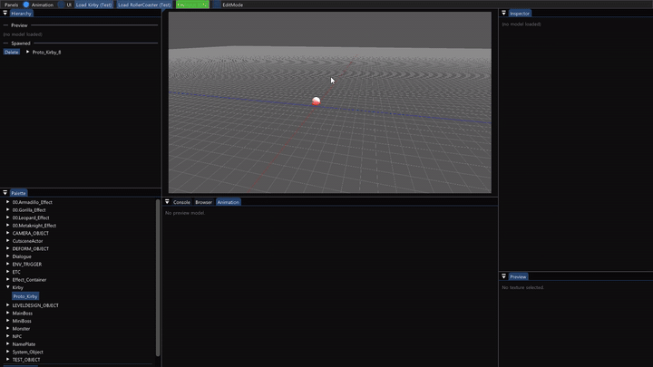
</p>

<details>
<summary><b>세부 구현 사항</b></summary>

- 생성
  - 오브젝트 팩토리(팀장)의 등록 목록을 분류별 버튼으로 보여 줌
  - 누르면 그 객체의 리소스만 불러와 생성
  - 레벨 전체를 띄우지 않고, 몬스터 하나를 실제 게임 객체로 확인
- 배치 환경
  - 300 × 300 크기의 정적 충돌 바닥을 깔아, 생성한 객체가 떨어지지 않고 서 있게 함
  - 생성한 객체는 Hierarchy에 쌓이고, 파츠를 고르면 그 파츠의 Animator로 이벤트를 저작

<sub>코드 · [`CPanel_Palette`](https://github.com/ddoichaboom/DX11_3D_GameProject_Team/blob/5cf52376ca5d1a02ebb6c31256e7fa08ef0c6b49/AAA/AnimUITool/Private/Panel_Palette.cpp#L13-L55) · [`CLevel_Tool::Spawn_Object`](https://github.com/ddoichaboom/DX11_3D_GameProject_Team/blob/5cf52376ca5d1a02ebb6c31256e7fa08ef0c6b49/AAA/AnimUITool/Private/Level_Tool.cpp#L1243-L1270) · [`Ready_TestGround`](https://github.com/ddoichaboom/DX11_3D_GameProject_Team/blob/5cf52376ca5d1a02ebb6c31256e7fa08ef0c6b49/AAA/AnimUITool/Private/Level_Tool.cpp#L148-L189)</sub>

</details>

#### □ 뼈 구조 확인

<p align="center">
  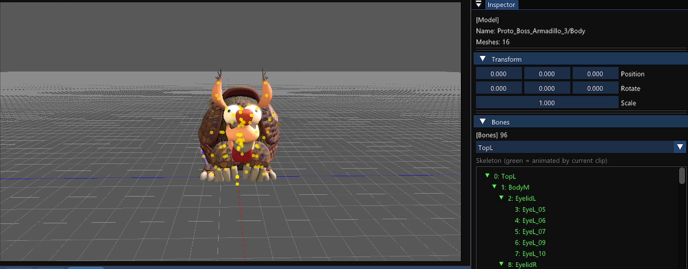
</p>

<details>
<summary><b>세부 구현 사항</b></summary>

- 본 트리
  - 본 배열의 부모 인덱스로 부모 → 자식 목록을 만들어 트리로 표시
  - 현재 클립이 움직이는 본은 초록색으로 칠하고, 클립이 쓰는 본 목록도 따로 보여 줌
- 본 위치
  - 각 본의 결합 행렬 위치를 월드 · 뷰 · 투영 행렬로 화면 좌표로 바꿈
  - 그 자리에 Viewport 위로 점을 그림
  - 트리에서 고른 본은 크고 빨간 점으로 강조

<sub>코드 · [`Render_Bones`](https://github.com/ddoichaboom/DX11_3D_GameProject_Team/blob/5cf52376ca5d1a02ebb6c31256e7fa08ef0c6b49/AAA/AnimUITool/Private/Panel_Inspector.cpp#L444-L551) · [`CPanel_Viewport::Render`](https://github.com/ddoichaboom/DX11_3D_GameProject_Team/blob/5cf52376ca5d1a02ebb6c31256e7fa08ef0c6b49/AAA/AnimUITool/Private/Panel_Viewport.cpp#L17-L90)</sub>

</details>

#### □ 애니메이션 저작

<p align="center">
  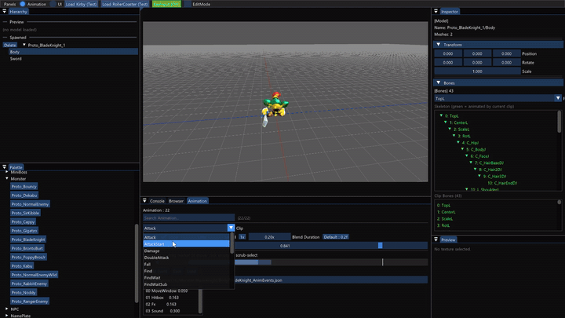
</p>

<p align="center">
  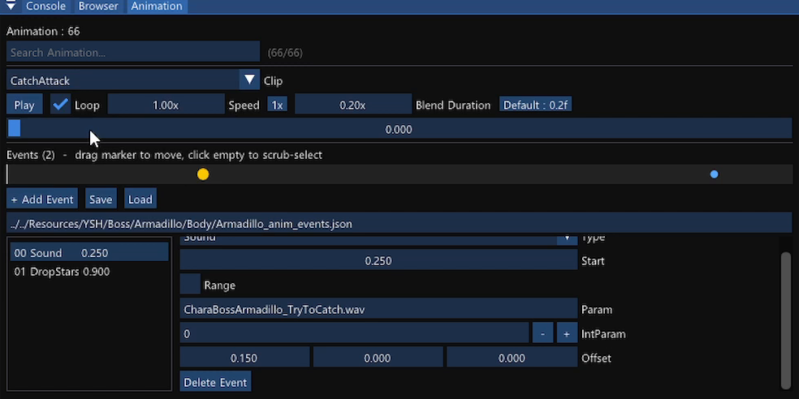
</p>

<details>
<summary><b>세부 구현 사항</b></summary>

- 재생
  - 클립 이름 검색과 보이는 행만 그리는 목록(`ImGuiListClipper`)으로 클립을 고름
  - 재생 · 정지 · 반복, 속도 · 블렌드 시간을 바꿔 보며 상태 코드에 넣을 값을 정함
  - 정지한 채 타임라인을 끌어 원하는 시점을 확인
- 이벤트 타임라인
  - 클립 길이와 상관없이 0 ~ 1 진행도 위에 이벤트는 점, 구간 이벤트는 띠로 그림
  - 누른 곳에서 8px 안의 가장 가까운 마커를 고르고, 끌 때만 옮김
  - 이벤트마다 종류 · 구간 여부 · 문자열 · 정수 · 오프셋 값을 넣고 JSON으로 저장
  - 이벤트 파일 경로는 모델 경로에서 자동으로 정함
- 게임과 같은 재생 경로
  - 모델을 직접 재생하지 않고 게임과 같은 Animator로 재생
  - 그래서 저작하는 동안에도 이벤트가 게임처럼 발화

<sub>코드 · [`CPanel_Animation::Render`](https://github.com/ddoichaboom/DX11_3D_GameProject_Team/blob/5cf52376ca5d1a02ebb6c31256e7fa08ef0c6b49/AAA/AnimUITool/Private/Panel_Animation.cpp#L43-L190) · [`Render_EventTimeline`](https://github.com/ddoichaboom/DX11_3D_GameProject_Team/blob/5cf52376ca5d1a02ebb6c31256e7fa08ef0c6b49/AAA/AnimUITool/Private/Panel_Animation.cpp#L202-L390) · [`CPreview_Actor::Update`](https://github.com/ddoichaboom/DX11_3D_GameProject_Team/blob/5cf52376ca5d1a02ebb6c31256e7fa08ef0c6b49/AAA/AnimUITool/Private/Preview_Actor.cpp#L42-L46)</sub>

</details>

#### □ UI 배치 모드 (초기)

<details>
<summary><b>세부 구현 사항</b></summary>

- 프로젝트 초반 UI를 함께 맡았을 때 같은 툴에 만든 모드로, 이후 UI 담당에게 넘김
- 설계 해상도 캔버스에서 파트 선택 · 이동 · 크기 조절
- 파트 추가와 JSON 저장 · 불러오기

</details>

### ■ 원작 리소스 파이프라인 (AnimModelTool)

팀장의 초안 변환기에서 변환 코어를 이어받아, C# 콘솔 툴(AnimModelTool)로 확장했습니다.<br/>
이 툴로 원작 리소스를 **엔진의 자체 모델 형식으로 바로 바꾸는** 파이프라인을 구성했습니다.<br/>
변환은 검사 → 모델 · 모션 분리 추출 → 베이크 순으로 나누고, 배치 메뉴로 실행하게 했습니다.

<p align="center">
  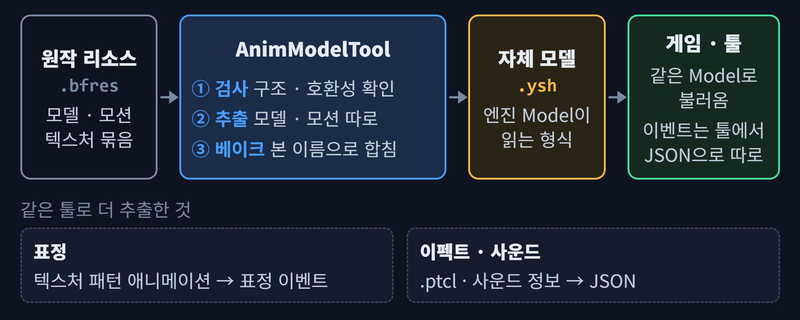
</p>

<details>
<summary><b>세부 구현 사항</b></summary>

#### □ 검사 먼저
- `inspect`(구조 식별) · `check`(모델 ↔ 모션 호환성 3분류)로 변환 전에 문제를 확인
- 매번 추출한 뒤 눈으로 확인하는 반복이 벅차, 변환 전에 확인하는 단계를 둠

#### □ 모델 · 모션 분리
- 모델은 `.ysh`(엔진 Model이 읽는 팀 자체 형식)로 추출
- 모션은 여러 클립을 묶은 `.AnimClips`로 따로 추출
- 둘은 **본 이름**으로 연결 (BFRES에는 모델 ↔ 모션 대응표가 없음)
- 추출한 모션을 모델과 합쳐 최종 `.ysh`로 베이크
- AnimUITool은 이 `.ysh`를 불러와 이벤트만 따로 JSON으로 저작

#### □ 포맷 분석으로 확장
- 원작 애니메이션이 스켈레탈 · 텍스처 · 셰이더 계열로 나뉜 것을 확인
- 표정은 텍스처 패턴 애니메이션을 분석해 표정 이벤트로 추출
- `.ptcl`(이펙트 컨테이너) · 사운드 정보까지 JSON으로 추출
- 원작 텍스처(BNTX)를 원래 포맷 그대로 `.dds`로 직추출
- 기존 재베이크 결과와 바이트 단위로 비교해 18개 모두 일치를 확인

#### □ 결과 · 운영
- 몬스터 · 보스 모델과 모션 전량, 이펙트 텍스처 3,773장 · 메시 929개 일괄 변환
- 배치 메뉴와 단독 실행 배포로, `Import` 폴더에 넣고 실행하면 되는 팀 공용 툴로 운영

#### □ 명령 구성

| 명령 | 하는 일 |
| --- | --- |
| `inspect` | `.bfres` · `.ysh`의 모델 · 클립 구성 확인 |
| `check` | 모델 스켈레톤과 모션 본의 호환 검사 (일치 / 모델에만 / 모션에만) |
| `extract-model` | 모델만 `.ysh`로 추출하고 머티리얼 정보를 JSON으로 (텍스처 `.dds` 선택) |
| `extract-anim` | 여러 모션을 하나의 `.AnimClips`로 합쳐 추출 |
| `extract-animinfo` | 표정(텍스처 패턴) · 본 가시성 · 머티리얼 커브 등 애니메이션 정보를 JSON으로 |
| `ptcl-inspect` | 이펙트(`.ptcl`)의 이미터 구성과 사용 텍스처 확인 |
| `ptcl-extract` | 이펙트 구성을 JSON으로 추출 (메시 · 텍스처 선택) |
| `extract-soundinfo` | 사운드 아카이브(`.bfsar`)의 이름표 · 파일 위치를 JSON · CSV로 |
| `bake` | 모델에 모션 키프레임을 합쳐 애니메이션이 든 `.ysh` 출력 |
| `bake-ysh` | 기존 `.ysh`에 클립을 더해 합침 (충돌 미리 검사 · 결과 보고서) |
| `probe-rm` | 루트 본의 이동 폭을 재 루트 모션이 필요한지 진단 |

</details>

### ■ 보조 툴

| 툴 | 하는 일 |
| --- | --- |
| **SoundMatchTool** (C#) | 시스템 오디오를 WASAPI 루프백(NAudio)으로 캡처해<br/>스펙트럼 지문으로 원본 사운드 파일을 찾아 줌 (세션 녹화 · HTML 리뷰) |
| **TextureRebake**<br/>**BfresTextureRebake** | 텍스처 색공간(sRGB / linear) 검사 · 재변환,<br/>원작 내장 텍스처를 원래 포맷 그대로 `.dds`로 추출 |
| **SpriteFontTool** | DirectXTK MakeSpriteFont에 폰트 파일 로딩을 추가한 수정본 |
| **EncodingCheck** | CP949 · UTF-8이 섞인 레포에서 변경 파일의 인코딩 사고(깨짐 · BOM · 줄바꿈) 검사 |
| **이펙트 텍스처 검색기** | 추출한 이펙트 텍스처 3,773장을 HTML 썸네일로 검색 |

---

## 회고

#### □ 애니메이션 데이터 포맷
- 처음에는 원작 애니메이션이 스켈레탈뿐인 줄 알고 모델과 함께 굽는 구조로 설계했음
- 나중에 찾은 표정(텍스처 패턴) · 이벤트 정보는 별도 JSON으로 흩어짐
- 모든 계열과 이벤트를 담는 단일 클립 포맷으로 처음부터 설계했다면 더 단순했을 것

#### □ 재생 구조의 절충
- 레이어를 도입하며 베이스까지 옮기고, 포즈 캡처로 재전환 끊김까지 막는 구조를 구상함
- 개발이 많이 진행된 시점이라, 베이스는 Model에 두고 레이어만 Animator로 옮기는 쪽을 택함
- 베이스의 끊김은 원인 2가지를 코드 줄 단위로 찾아, 포즈 캡처 수정안으로 정리해 둠

---

## 기술 스택

| 기술 | 활용 |
| --- | --- |
| C++ | Animator 확장(레이어 · 본 마스킹 · 큐), FSM 몬스터 AI(블랙보드 · Brain · 공용 상태) |
| DirectX 11 / HLSL | 4×4 Bayer 디더링 페이드, 폭탄 도화선이 타 들어가는 셰이더 |
| PhysX | 엔진 이동 컴포넌트(캐릭터 컨트롤러)를 상속한 몬스터 · 레일 이동, 버린 방울 이동 |
| FMOD | 채널 핸들 · 구간 반복 · DSP 클럭 페이드, 중첩 제한 · 리미터 · 버스 우선순위 |
| ImGui | 패널 매니저 기반 AnimUITool (이벤트 타임라인 · 본 트리 · 팔레트 배치) |
| nlohmann/json | 애니메이션 이벤트 저장 · 불러오기, AnimUITool UI 배치 저장 · 불러오기 |
| C# (.NET) | 원작 리소스 변환 툴 AnimModelTool · 오디오 지문 매칭 툴 SoundMatchTool |
| BfresLibrary | 원작 `.bfres`의 모델 · 스켈레탈 · 텍스처 패턴 애니메이션을 읽어 `.ysh`로 변환 |
| 수학 | 쿼터니언 Slerp · 거리 매개화 · 균일 원형 샘플링 · 상자 표면 거리 |
| 자료구조 · 최적화 | 덱 · 해시 맵 · 오브젝트 풀, 거리 기반 애니메이션 갱신 주기 · 위상 분산 |
| 설계 | 지각 · 판단 · 실행 분리 · 템플릿 메서드 · 가상 함수 분리 · 값 타입 핸들 · 데이터 주도 |

---

> 이 프로젝트는 「별의 커비 디스커버리」를 모작한 비상업적 목적의 학습 프로젝트입니다.<br/>
> 프로젝트에 사용한 리소스와 캐릭터를 비롯한 모든 저작권은 닌텐도와 HAL 연구소에 있습니다.<br/>
> 원작 에셋은 이 저장소에 포함되어 있지 않습니다.
